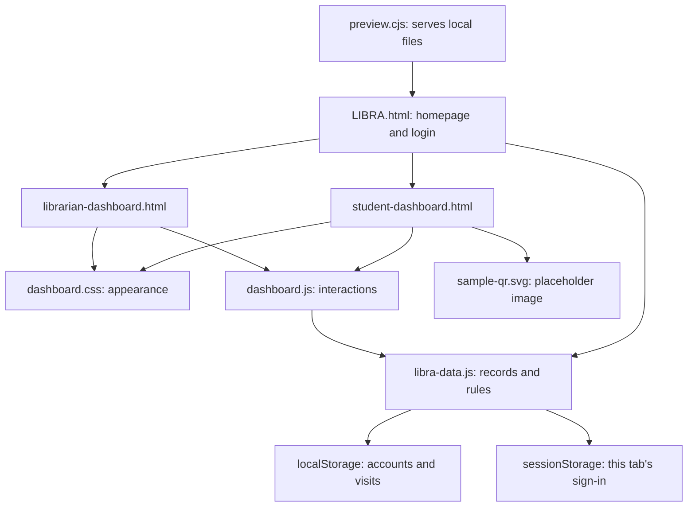

# LIBRA code explanation guide

This guide explains every project file and its main code sections in plain English. Open a file beside this guide and use **Ctrl+F** to find the function, class, or element ID shown in backticks. Examples show small parts of the existing code.

The setup commands and demo login details are in [README.md](README.md).

## File map

| File | Its job | Explanation |
| --- | --- | --- |
| [LIBRA.html](LIBRA.html) | Homepage, login popup, and smooth section navigation. | [Homepage code](#home-file) |
| [student-dashboard.html](student-dashboard.html) | Student dashboard layout and forms. | [Student page](#student-file) |
| [librarian-dashboard.html](librarian-dashboard.html) | Librarian dashboard layout, tables, and manual-entry form. | [Librarian page](#librarian-file) |
| [dashboard.css](dashboard.css) | Shared dashboard colors, fonts, spacing, and responsive layout. | [Dashboard styles](#css-file) |
| [dashboard.js](dashboard.js) | Dashboard navigation, displayed values, filtering, forms, and chart drawing. | [Dashboard interactions](#dashboard-script) |
| [libra-data.js](libra-data.js) | Shared demo records, sessions, profile rules, and entry recording. | [Data and rules](#data-file) |
| [sample-qr.svg](sample-qr.svg) | Static sample QR artwork. | [QR artwork](#qr-file) |
| [preview.cjs](preview.cjs) | Local server that serves the application files. | [Preview server](#server-file) |
| [tests/libra-data.test.cjs](tests/libra-data.test.cjs) | Automated checks for the data and account rules. | [Data tests](#data-tests) |
| [tests/libra-pages.test.cjs](tests/libra-pages.test.cjs) | Automated checks for page structure and local file references. | [Page tests](#page-tests) |
| [README.md](README.md) | Instructions for running and trying the demo. | [Documentation files](#documentation-files) |
| [CODE_GUIDE.md](CODE_GUIDE.md) | This explanation guide. | [Documentation files](#documentation-files) |

## How the files work together

**HTML builds the page, CSS styles it, and JavaScript makes it respond to actions.** The dashboards share the same styles and data code so they look consistent and read the same saved records.



For example, clicking **Record entry** runs a handler in `dashboard.js`. That handler calls `recordManualEntry()` in `libra-data.js`. The new record is saved, and the dashboard reads the updated records to show the new entry and totals.

## Useful terms before reading the code

| Term | Meaning in this project |
| --- | --- |
| HTML element | A part of the page, such as a button, heading, input, or table. |
| `id` | An element's unique name within a page. JavaScript uses IDs to find the element to update. |
| `class` | A reusable label for styling or selecting elements. Several elements can share a class. |
| `data-*` attribute | Extra information attached to an HTML element, such as its dashboard role or view name. |
| DOM | The browser's representation of the HTML page. JavaScript reads and changes this representation. |
| Object | Related values grouped together, such as one student's name, number, and program. |
| Array | A list of values, such as all students or all attendance records. |
| `const` / `let` | Variables. `const` keeps the same assigned reference; `let` can be reassigned. An object stored in a `const` can still have its contents changed. |
| Function | A named set of instructions that can be called when needed. |
| Event handler | A function connected to an action, such as a click, input change, or form submission. |
| Render | Read data and update the visible page with it. |
| State | The current collection of saved accounts and attendance records. |
| JSON | A text format used to save JavaScript data in browser storage. |
| Promise / `async` / `await` | A way to wait for an operation's result before continuing, such as waiting for a profile save. |
| URL hash | The part of an address starting with `#`, such as `#history`. It identifies a section or dashboard view. |
| `aria-*` | Attributes that describe controls and their state to assistive tools, including screen readers. |

The array helpers used frequently are `filter()` to keep matching items, `find()` to get one matching item, `map()` to transform each item, and `forEach()` to run instructions for each item.

<a id="home-file"></a>

## 1. LIBRA.html — homepage and login

### Document setup and the head

Find `<!DOCTYPE html>`, `<html lang="en">`, and `<head>` at the top.

- `<!DOCTYPE html>` tells the browser to use modern HTML rules.
- `lang="en"` identifies the page's language.
- `charset="UTF-8"` supports characters such as arrows and accented letters.
- The viewport setting makes the layout respond to the device's screen width.
- `<title>` supplies the browser tab's title.
- The Google Fonts links load Manrope. `preconnect` prepares connections to the font hosts. CSS supplies Segoe UI and a general sans-serif fallback.

The large `<style>` block contains the homepage's CSS. Dashboard styling is maintained separately in `dashboard.css`.

### Homepage style sections

| Code to find | What this group styles |
| --- | --- |
| `:root` | Named theme values such as `--green`, `--gold`, `--background`, and `--header-height`. Other rules reuse these values through `var(...)`. |
| `*`, `html`, `body`, `a`, `button`, `input` | Basic sizing, font, background, link appearance, and inherited form fonts. `box-sizing: border-box` includes padding and borders in an element's declared size. |
| `section[id]` | Space above an anchor's destination, accounting for the sticky header. |
| `:focus-visible` | A visible gold outline for keyboard navigation. |
| `.topbar` | The dark university information strip above the main header. |
| `header`, `.nav-wrap`, `.brand`, `.seal`, `nav`, `.nav-actions` | The sticky header, LIBRA branding, navigation links, and login-button arrangement. |
| `.btn`, `.btn-primary`, `.btn-outline`, `.menu-toggle` | Reusable button shapes, colors, hover effects, and the smaller-screen menu control. |
| `.hero`, `.hero-inner`, `.eyebrow`, `h1` | The welcome section, library background image, green overlay, and large heading. |
| `.container`, `.panel`, `.section-heading`, `.two-col` | Content width, white cards, section titles, and side-by-side panels. |
| `.feature-grid`, `.feature-card`, `.symbol` | The three library-service cards and their symbols. |
| `.announcement`, `.date-tag` | Announcement rows, their separators, and small labels. |
| `.steps`, `.step`, `.step-number` | The four check-in steps and numbered circles. |
| `footer`, `.footer-inner` | The dark green project footer. |
| `.modal-backdrop`, `.modal`, `.modal-actions` | The dimmed overlay, centered login popup, and shared Cancel / Sign In buttons. |
| `.login-tabs`, `.login-tab`, `[aria-selected="true"]` | The Student Login and Librarian Login tabs, including the selected-tab appearance. |
| `label`, `input`, `.notice`, `.demo-login-hint` | Login fields, focus styling, demo credentials, and feedback messages. |

The `@media` blocks adjust the homepage at **960px** and **600px**. They reveal the menu button, simplify the brand on small screens, and stack content into fewer columns. The reduced-motion block removes smooth CSS scrolling and transitions when the visitor requests less animation.

### Visible homepage sections

| HTML section | What it displays |
| --- | --- |
| `.topbar` | University and library-service information. |
| `<header>` and `mainNav` | Brand link, About, Services, Updates, How it works, and Access LIBRA. The brand link returns to `#home`. |
| `id="home"` | Welcome message and introductory description. |
| `id="about"` | The LIBRA explanation and project goal. |
| `id="services"` | Descriptions of student QR registration, visit attendance, and library information. |
| `id="announcements"` | Sample library reminders and updates. |
| `id="how"` | Student login, getting a QR, scanning it, and recording a check-in. |
| `<footer>` | Project name, prototype description, and copyright. |

The section IDs match the navigation's `href` values. For example, `href="#services"` identifies the element with `id="services"`.

### Login popup HTML

Find `loginModal`, `loginForm`, `studentLoginPanel`, and `librarianLoginPanel`.

The popup contains two tab buttons and one shared form. The student panel asks for a student number and password. The librarian panel asks for a librarian ID and password. A hidden input named `loginRole` records which role is selected.

The inactive panel is hidden, and its inputs are disabled. Disabled inputs do not participate in form validation or submission, so an empty hidden librarian field cannot block a student login. Both panels use the same form's **Sign In** button.

`role="dialog"`, `role="tablist"`, `role="tab"`, and `role="tabpanel"` describe the popup's structure. `aria-controls`, `aria-labelledby`, and `aria-selected` connect the tabs to their panels and identify the active choice.

### Script loading and initial references

Near the bottom, `<script src="libra-data.js">` loads the shared data code before the homepage's inline script runs.

The first `const` declarations find the popup, form, tabs, header, and navigation. `reducedMotion` reads the visitor's animation preference. `scrollFrame` remembers the scheduled animation frame so the code can cancel it.

### Menu and header functions

| Function | What it does |
| --- | --- |
| `setMenuOpen(open)` | Adds or removes the navigation's `open` class and updates the menu button's accessible label and expanded state. |
| `updateHeaderHeight()` | Measures the header and writes the result into `--header-height`. It closes the small-screen menu above 960px. |
| `toggleMenu()` | Switches between an open and closed menu. The menu button calls this function. |

`ResizeObserver` watches the header's size, and the window's `resize` event checks it after screen-size changes. This keeps anchor spacing accurate when the header's layout changes.

### Smooth-scroll functions and navigation events

`stopScroll()` cancels the pending animation frame. It is called before another scroll begins and when the visitor uses the wheel, touches the screen, or presses a scrolling key.

`scrollToSection(target)` calculates the destination from the target section's position. It subtracts the header height and **16px** of space, then keeps the destination within the page's scrollable limits.

Its inner function, `animateScroll(timestamp)`, runs through `requestAnimationFrame()` for **600 milliseconds**. It calculates progress and applies an easing formula, making movement start gently, speed up, and slow down near the end. Each frame sets a small new scroll position.

You will see `behavior: 'instant'` inside this function. Each individual position is applied immediately; the sequence of many positions creates the smooth animation. Reduced-motion visitors move directly to the destination. The target receives keyboard focus without triggering a second scroll.

The `a[href^="#"]` click handler:

1. Finds the target section.
2. Prevents the browser's immediate default anchor jump.
3. Closes the mobile menu.
4. Uses `history.pushState()` to update the URL hash.
5. Updates the selected navigation link and starts the animation.

`updateCurrentLink()` compares each link's hash with the current address and sets `aria-current="location"` on the matching link. It follows the selected URL section. Hash changes refresh it, while browser-history movement cancels an active animation.

### Login tabs, opening, and closing

`selectLoginRole(role)` switches the active tab and panel. It updates `loginRole`, `aria-selected`, keyboard tab order, panel visibility, enabled fields, the popup description, and the demo credential hint. It also clears old feedback.

Each tab has a click handler. Its keyboard handler supports Left / Right arrows, Home, and End, then focuses the selected tab.

`openLogin()` stops any scroll animation, closes the navigation menu, selects Student Login, shows the popup, and focuses the student-number field.

`closeLogin()` hides the popup, resets the form, returns to the student tab, and focuses Access LIBRA. Clicking the dimmed backdrop closes the popup; clicking inside the form keeps it open. Escape closes the popup or the open navigation menu.

### Sign-in submission and login query

The `loginForm` submit handler prevents the normal page submission and calls `reportValidity()` to check the active required fields. It reads the selected role's identifier and password, then calls:

```javascript
window.LibraDemo.signIn(role, identifier, password);
```

A successful student sign-in opens `student-dashboard.html`; a librarian sign-in opens `librarian-dashboard.html`. An error is displayed in `loginNotice`.

The final `requestedLogin` block reads an address such as `LIBRA.html?login=librarian`. It automatically opens the correct tab. Dashboard redirects use this when the requested dashboard has no matching signed-in account.

<a id="student-file"></a>

## 2. student-dashboard.html — student page structure

### Head and role selection

The head loads Manrope, `dashboard.css`, `libra-data.js`, and `dashboard.js`. The scripts use `defer`: they download while the browser reads the HTML and run after the page has been parsed, in their listed order.

This body attribute selects the student behavior in the shared controller:

```html
<body data-dashboard="student">
```

### Left navigation and shared page shell

The `sidebar` aside contains the LIBRA home link, navigation, reminder card, account details, and `signOutButton`.

Each navigation link has a URL hash and `data-view`, for example:

```html
<a class="sidebar-link" href="#history" data-view="history">
```

The matching content section has `data-panel="history"`. `dashboard.js` shows the matching panel and hides the others. `aria-current="page"` identifies the selected navigation link.

The circular avatar and elements with `.account-name`, `.account-id`, and `.account-initials` are filled with the signed-in account's details. The inline SVG elements draw the navigation icons.

`sidebarToggle` opens the navigation as a left drawer on small screens. `sidebarBackdrop` dims the rest of the page while the drawer is open. The skip link takes keyboard users to `dashboardMain`.

The topbar contains university information, `currentDate`, and the demo badge. The main heading uses `viewTitle` and `viewDescription`, which change with the selected view. `appError` holds an application-level error message. The footer's `.current-year` is updated by JavaScript.

### Overview section

Find `data-panel="overview"`.

The welcome banner contains `welcomeName`. Three statistic cards use `studentTotalVisits`, `studentMonthVisits`, and `studentLastVisit` / `studentLastTime` as places for JavaScript to insert values.

The QR card displays `sample-qr.svg` through an ``. The student's number, name, and program are displayed around it. The artwork is a preview placeholder containing no student data.

`studentRecentVisits` is the table body for the student's three most recent visits. It starts empty because the controller builds its rows from saved records. The final reminder card describes the check-in steps.

### Visit history section

Find `data-panel="history"`.

`historyFrom`, `historyTo`, and `historyMethod` filter the current student's records by date range and entry method. Leaving dates empty includes all dates. `historyMessage` displays an invalid date-range message.

The `studentHistoryRows` table body displays date, time, entry method, and recorded status. `historyCount` shows the number of matching visits. `historyPrev`, `historyNext`, and `historyPageInfo` control and describe the current group of rows.

### Profile settings section

Find `profileForm` inside `data-panel="profile"`.

| Element | Purpose |
| --- | --- |
| `profileStudentNumber` | Read-only student identifier. |
| `profileName` | Editable name, with required and length constraints. |
| `profileProgram` | Program choices populated from the shared `PROGRAMS` list. |
| `profileEmail` | Required email field with browser email-format checking. |
| `data-profile-field` | Marks the three editable fields so the controller can disable them together. |
| `profileAgreement` | Required acknowledgement of the one-time save rule. |
| `profileSaveButton` / `profileActions` | Submit control and its wrapper; the wrapper is hidden after the update is used. |
| `profileRule`, `profileUpdateBadge`, `profileStatus` | Explain whether the update is available or already used. |
| `profileMessage` | Save success or error feedback. |

The summary card shows the saved account details. The one-time rule applies to **one successful save of the whole profile**, covering name, program, and email together. `libra-data.js` checks that rule when saving, and `dashboard.js` makes the form read-only afterward.

Table captions use `.sr-only` to provide descriptions to screen readers. `scope="col"` identifies table headings, and message regions use `role="status"` or `role="alert"`.

<a id="librarian-file"></a>

## 3. librarian-dashboard.html — librarian page structure

### Head, role, navigation, and page shell

This file loads the same styles and scripts as the student page, using:

```html
<body data-dashboard="librarian">
```

The shared script reads this value and activates the librarian views. The left navigation links to `overview`, `traffic`, `attendance`, `directory`, and `manual`. Each link's `data-view` matches a section's `data-panel`.

The branding, account display, sign-out control, topbar, mobile drawer, main heading, error region, and footer follow the same structure as the student page. The librarian account display uses a librarian ID.

### Library overview

Find `data-panel="overview"`.

`todayEntries`, `registeredStudents`, and `peakHour` display today's total entries, the registered-account count, and the busiest hour. `peakHourNote` describes the peak count.

`librarianRecentEntries` contains today's six latest check-ins. The entry-method panel uses `qrEntryCount`, `manualEntryCount`, `qrProgress`, and `manualProgress` for counts and percentage bars.

`uniqueVisitors` counts individual students today. A student visiting three times contributes three entries and one unique visitor. Library hours and the time-zone label are informational text in the HTML.

### Visitor traffic

Find `data-panel="traffic"`.

The statistic cards use `trafficTotal`, `trafficUnique`, `trafficPeak`, and `trafficPeakCount`. The `trafficChart` container receives SVG chart markup generated by `renderTraffic()`.

The chart covers all 24 hours of the current day. Green bars represent entries, gold marks the selected peak hour, and pale bars represent zero-count hours. The actual zero count remains zero even though a small baseline bar is visible.

`trafficReadout` describes the bar being pointed to or focused with the keyboard. `hourlyBreakdown` receives 24 small hour-and-count cards. `trafficDate` shows the current date.

### Attendance log

Find `data-panel="attendance"`.

- `attendanceSearch` searches student names and numbers.
- `attendanceDate` starts at today; clearing it includes all dates.
- `attendanceProgram` filters entries by recorded program.
- `attendanceRows` receives Student, Student No., Program, Date, Time, and Entry method columns.
- `attendanceCount`, `attendancePrev`, `attendanceNext`, and `attendancePageInfo` show the result count and pagination.

Attendance records retain the name and program captured when the entry was recorded. A later profile update changes the directory's current details while preserving those historical rows.

### Student directory

Find `data-panel="directory"`.

`directorySearch` and `directoryProgram` filter registered accounts. `directoryRows` displays name, student number, program, email, and whether the profile update is Available or Used. The remaining `directory*` controls provide a count and pagination.

This section reads the current student objects, so successfully saved profile changes appear here.

### Quick / manual entry

Find `manualEntryForm` inside `data-panel="manual"`.

The librarian enters a number in `manualStudentNumber`. A matching registered account appears in `manualStudentPreview`, using `previewName`, `previewStudentNumber`, `previewProgram`, and `previewInitials`.

`manualLookupMessage` provides lookup feedback. `manualSubmit` is disabled until the number matches a registered account. Submission calls the shared entry-recording function, then `manualEntryMessage` shows the result.

The right-hand table, `manualRecentRows`, shows today's five latest manual entries. The actual date, time, and saved attendance record are created in `libra-data.js`.

<a id="css-file"></a>

## 4. dashboard.css — shared dashboard appearance

### Theme variables and basic rules

`:root` defines the shared palette and sidebar width. An extract is:

```css
--green: #176b3a;
--gold: #f4c542;
--background: #f5f8f5;
--sidebar-width: 248px;
```

Using named values keeps the dashboards' cards, buttons, and navigation consistent. The homepage has its own corresponding variables in `LIBRA.html`.

The first global rules set sizing, font inheritance, link appearance, and focus outlines. `[hidden] { display: none !important; }` ensures a hidden dashboard panel stays hidden even when its normal layout uses `display: grid`.

### Component style groups

| Code to find | What it controls |
| --- | --- |
| `.icon`, `.seal` | SVG icon strokes and the circular LIBRA mark. Icons use `currentColor` to inherit the surrounding text color. |
| `.skip-link`, `.sr-only`, `:focus-visible` | Keyboard shortcuts to content, screen-reader descriptions, and visible focus outlines. |
| `.sidebar`, `.sidebar-brand`, `.workspace-label` | The fixed left column, branding, and small navigation-group label. |
| `.sidebar-nav`, `.sidebar-link`, `[aria-current="page"]` | Sidebar spacing, link hover appearance, and the active link's green highlight and marker. |
| `.sidebar-note`, `.sidebar-account`, `.account-row`, `.account-details`, `.avatar`, `.sign-out` | The reminder, signed-in identity, circular initials, and sign-out button. |
| `.main-shell`, `.dashboard-topbar`, `.topbar-title`, `.topbar-meta` | Main content's offset from the sidebar and the sticky header. |
| `.menu-button`, `.sidebar-backdrop` | The mobile navigation control and dimmed backdrop. |
| `.workspace`, `.page-heading`, `.eyebrow`, `.view` | Main content width, padding, headings, and gaps between sections. |
| `.welcome-banner`, `::before`, `::after` | The green welcome card and its decorative background circles. The circles do not intercept clicks. |
| `.stats-grid`, `.stat-card`, `.stat-label`, `.stat-value`, `.stat-note`, `.stat-icon` | The metric-card layout, labels, numbers, notes, and icons. `.compact` fits longer date or hour text. |
| `.panel`, `.panel-heading`, `.stack`, `.overview-grid`, `.librarian-overview-grid` | White cards and the main arrangements of neighboring cards. |
| `.qr-panel`, `.qr-frame`, `.qr-number`, `.qr-name`, `.qr-caption`, `.qr-divider` | QR image size, centering, student labels, explanation, and separator. |
| `.soft-panel`, `.reminder-list`, `.reminder-number`, `.detail-row` | Green information cards, numbered reminders, and label-value rows. |
| `.table-wrap`, `table`, `th`, `td`, `.student-cell`, `.program-cell`, `.nowrap`, `.empty-state` | Table spacing, readable headings, student labels, long programs, and empty results. The wrapper allows horizontal scrolling on small screens. |
| `.filters`, `.field`, `.search-field`, `.filter-field`, `.filter-program` | Labels, inputs, selectors, and flexible filter layouts. Read-only or disabled controls receive a muted background. |
| `.pagination`, `.pagination-buttons`, `.btn`, `.btn-primary`, `.btn-outline`, `.btn-small` | Page-control layout and reusable button appearances. |
| `.profile-grid`, `.profile-form`, `.profile-fields`, `.full-width`, `.agreement`, `.form-actions`, `.profile-summary`, `.large-avatar` | Profile form spacing, the acknowledgement checkbox, save-button alignment, and account summary. |
| `.notice`, `.notice.success`, `.notice.error`, `.app-error` | Information, successful-save, and error messages. |
| `.badge`, `.badge-green`, `.badge-gold`, `.badge-neutral` | Small status labels used throughout the dashboards. |
| `.method-row`, `.method-label`, `.progress-track`, `.progress-fill` | QR and manual-entry percentage bars. JavaScript supplies each fill's width. |
| `.chart-scroll`, `.traffic-chart`, `.chart-grid`, `.chart-label`, `.chart-bar`, `.chart-footer`, `.chart-legend`, `.legend-dot` | Chart size, axes, bars, hover / focus appearance, and legend. `.peak` and `.zero` select special colors. |
| `.hourly-grid`, `.hour-card` | The 24 hourly-count cards and peak-hour highlighting. |
| `.manual-grid`, `.manual-form`, `.student-preview`, `.manual-instructions` | The manual-entry form, matching student preview, instructions, and neighboring table. |
| `.workspace-footer` | The small project and sample-data labels below the content. |

### Responsive layout and motion preferences

The media queries apply progressively as the available width gets smaller:

| Rule | Main adjustment |
| --- | --- |
| `max-width: 1180px` | Narrows the sidebar and padding, and stacks the librarian overview's main columns. |
| `max-width: 960px` | Moves the sidebar off screen, reveals the menu button, and lets the content use the full width. `.sidebar.open` slides the drawer in from the left. |
| `max-width: 700px` | Stacks overview, profile, and manual-entry columns; simplifies header details; and makes filters fit narrower widths. |
| `max-width: 400px` | Stacks metric cards and pagination controls and reduces hourly-card columns. |
| `prefers-reduced-motion: reduce` | Removes transitions and smooth scrolling for visitors who request reduced animation. |

The 960px navigation breakpoint also appears in `dashboard.js`. Keep those values in agreement when changing the drawer behavior.

<a id="dashboard-script"></a>

## 5. dashboard.js — dashboard interactions

### Wrapper, role, and working variables

The opening `(function () { ... })();` creates a function and runs it immediately. It keeps the controller's variables inside that function. `'use strict'` enables stricter JavaScript error checking.

`demo` points to `window.LibraDemo`, the shared data object. `role` reads `document.body.dataset.dashboard`. `byId` is a short helper for `document.getElementById()`.

`views` maps the allowed view names to their headings and descriptions. The role determines which set of views is available.

| Variable | Why it is kept |
| --- | --- |
| `pages` | Remembers the current page number for history, attendance, and directory tables. |
| `PAGE_SIZE` | Sets the table page size to 10 rows. |
| `activeView` | Identifies the currently displayed dashboard panel. |
| `profileLoadedFor`, `profileLoadedUpdate` | Remember which saved profile was loaded into the form. This prevents routine data refreshes from overwriting unsaved edits. |
| `profileSaving`, `manualSaving` | Track a save in progress and prevent repeated submissions. |
| `lastDay` | Lets the timer detect when the current date has changed. |

### Small display helpers

| Function | Purpose |
| --- | --- |
| `escapeHtml(value)` | Converts characters such as `<` and `&` into text-safe HTML forms when constructing table rows. A name containing those characters stays text. |
| `initials(name)` | Builds up to two initials for an avatar. |
| `setText(id, value)` | Updates one element's text when the element exists on that page. |
| `fillText(selector, value)` | Updates all matching elements, such as every `.account-name`. |
| `sortedVisits(visits)` | Returns a copied list sorted newest first by saved timestamp. |
| `entryBadge(method)` | Builds the small QR or Manual label for a table row. |
| `studentCell(visit)` | Builds a student's name and number together for compact tables. |
| `emptyRow(columns, message)` | Creates one explanatory cell spanning the table's columns when results are empty. |
| `showMessage(id, message, type)` | Shows feedback with information, success, or error styling. |
| `updateAccount(account)` | Fills identity labels, initials, welcome name, current date, and copyright year. |
| `peakText(stats)` | Turns the peak-hour number into a range such as `9 AM – 10 AM`, or displays No entries. |

Text is usually inserted through `textContent`. When the controller builds HTML strings, student names, emails, programs, and other text pass through `escapeHtml()`.

### Table pagination

`paginate(prefix, rows, rowRenderer, columns, noun, emptyMessage)` is shared by the three larger tables.

It calculates the number of pages, keeps the current page in a valid range, takes up to `PAGE_SIZE` rows, and uses `rowRenderer` to build each row's HTML. It also updates the showing-X-to-Y label and disables Previous / Next at the first or last page.

The history table has a special body ID, `studentHistoryRows`; the others use `attendanceRows` and `directoryRows`. If filters reduce the results, pagination adjusts to a valid page.

### View-rendering functions

| Function | What it reads and updates |
| --- | --- |
| `renderStudentOverview(account, state)` | Filters visits to the signed-in student, calculates total and current-month visits, finds the latest entry, and fills the three-row recent-history table. |
| `renderHistory(account, state)` | Applies the student's date and method filters, reports an invalid date range, and paginates matching visits. |
| `renderProfile(account)` | Loads saved profile values, updates availability messages, and disables editable controls when the profile update is used or a save is in progress. |
| `renderLibrarianOverview(state)` | Calculates today's totals, peak hour, unique visitors, entry-method percentages, and six latest check-ins. |
| `renderTraffic(state)` | Builds the current day's hourly SVG chart, statistic cards, and 24 hourly-count cards. |
| `renderAttendance(state)` | Applies name / number, date, and program filters to attendance records and paginates the result. |
| `renderDirectory(state)` | Filters current student accounts, sorts by student number, and builds the directory with profile-update status. |
| `lookupManualStudent(state)` | Finds a student matching the entered number, fills the preview, and enables Record entry only for a match while no save is pending. |
| `renderManual(state)` | Refreshes the student lookup and lists today's five most recent manual entries. |

`renderProfile()` checks `Boolean(account.profileUpdatedAt)` to decide whether the profile is locked. It hides the acknowledgement and save controls after the update is used. The actual permission to save is checked again by `updateProfile()` in the data file.

`lookupManualStudent()` shows an unmatched-number message once the entered text reaches the sample student-number length of nine characters.

### How the traffic chart is drawn

`renderTraffic()` receives the 24 counts from `trafficForDay()` and constructs SVG elements:

1. It chooses a vertical maximum of at least 4, rounded upward to a multiple of 4.
2. It draws five horizontal grid levels and their labels.
3. It creates one rectangle for each hour. The rectangle's height is its count divided by the vertical maximum, multiplied by the chart height.
4. It marks the peak hour and zero-count hours with CSS classes.
5. It adds hour labels, readable bar descriptions, and a time-zone label.

For a maximum of 8, a count of 6 uses 75% of the available chart height. The chart's `title`, `desc`, individual `aria-label` values, and focusable bars describe its data to assistive tools. Pointer and keyboard-focus handlers also update `trafficReadout`.

### Main rendering and account check

`render()` is the controller's main refresh function. It asks `currentAccount(role)` for a matching account. If none is found, it redirects to `LIBRA.html?login=student` or `LIBRA.html?login=librarian`.

For a signed-in account, it gets the latest saved state, updates account labels, and calls the renderer for the active view. Errors appear in `appError`.

### Switching views and controlling the mobile sidebar

`switchView(focus)` reads the URL hash, checks it against `views`, and falls back to Overview when the name is unknown. It shows the matching `data-panel`, updates the selected link and headings, closes the mobile drawer, and calls `render()`.

When called after navigation, it returns the page to the top and focuses the new heading. Homepage navigation scrolls between sections; dashboard navigation selects a content view.

`setSidebarOpen(open, restoreFocus)` controls the drawer at 960px or below. It changes the `open` class, backdrop, accessible labels, and page-scroll state. A closed mobile sidebar is `inert`, preventing its off-screen links from receiving focus. Closing through the backdrop or Escape can return focus to the menu button.

### Event handlers and initial setup

| Code section | Action it connects |
| --- | --- |
| `[data-view]` click handlers | Update the hash through `history.pushState()` and select the requested view. Modified clicks retain normal browser link behavior. |
| `popstate` and `hashchange` | Keep the visible view synchronized with Back / Forward and hash changes. |
| `sidebarToggle`, `sidebarBackdrop`, and the `mobile` media-query listener | Open or close the left drawer as the control or screen size changes. |
| Document `keydown` handler | Close an open drawer with Escape and keep Tab navigation cycling within its controls. |
| `signOutButton` handler | Remove this tab's demo session, then return to the homepage. |
| Previous / Next handlers | Change the table's page number and refresh its rows. |
| Student setup block | Populate the profile program selector, connect history filters, and clear old profile feedback while details are edited. |
| `profileForm` submit handler | Check browser field validation and the acknowledgement, capture the values, show a saving state, await `demo.updateProfile()`, and display the result. |
| Librarian setup block | Populate program filters, preset attendance to today, and connect live search and date / program changes. |
| Chart `pointerover` and `focusin` | Read the targeted bar's description and display it in the chart footer. |
| `manualStudentNumber` input handler | Clear old submission feedback and refresh the matching-account preview. |
| `manualEntryForm` submit handler | Validate the field, prevent repeated submission, await `demo.recordManualEntry()`, and show feedback. On success it clears and focuses the number field. |

Both asynchronous submit handlers use `try`, `catch`, and `finally`: attempt the operation, show any error, then restore the saving flag and refresh the form.

The final listeners refresh saved data in different situations:

- `libra:datachange` refreshes the page after a successful write in this window.
- The browser's `storage` event refreshes it after another tab changes the shared records.
- `visibilitychange` refreshes a tab when it becomes visible again.
- A 60-second timer detects a new day and refreshes daily statistics. If the attendance date was still the previous day, it advances that filter too.

The final `switchView()` call displays the initial view from the current address. The timer refreshes today's view; sample records are created by the data file when a saved dataset is first needed.

<a id="data-file"></a>

## 6. libra-data.js — shared data and application rules

### Browser and Node wrapper

The outer function receives `root` and `factory`. `factory()` builds the shared functions and configuration.

In a browser, the wrapper creates a store and assigns it to `window.LibraDemo`. In Node, `module.exports` exposes the factory functions and helpers so the tests can call the same application code.

The browser store receives adapters for `localStorage` and `sessionStorage`, a `notify` callback, and a `lock` callback. `notify` dispatches `libra:datachange` after a successful save.

When `navigator.locks` is available, `lock` uses a named Web Lock to run one data write at a time across tabs using the same site address. The fallback runs the action through a Promise. Cross-tab serialization is provided by the supported Web Lock branch.

### Configuration constants

| Constant | Meaning |
| --- | --- |
| `DATA_KEY` | `libra.demo.data.v1`, the browser-storage name for the saved dataset. |
| `SESSION_KEY` | `libra.demo.session.v1`, the name for this tab's sign-in information. |
| `TIME_ZONE` | `Asia/Manila`, used to interpret library dates and hours. |
| `DEMO_PASSWORD` | The shared public demo password, `libra123`. |
| `PROGRAMS` | The list used by seeded accounts, selectors, filters, and profile validation. |
| `dayFormatter` | A reusable date formatter that produces year, month, and day parts in Philippine time. |

`localStorage` keeps accounts, visits, and profile-update timestamps across reloads and sign-outs. `sessionStorage` keeps the current role and account identifier for one browser tab. Pages opened from the same protocol, host, and port share the stored dataset. The preview server gives the separate HTML pages that common address.

### Date, time, and traffic helpers

| Function | What it does |
| --- | --- |
| `dateKey(value)` | Produces a Philippine-date string such as `2026-11-23`, suitable for date filtering. |
| `formatDate(value, options)` | Produces readable dates. Date-only strings are interpreted at midday in Philippine time so the intended day is retained. Options can hide the year or show the month alone. |
| `formatTime(value)` | Formats a timestamp as a local time such as `12:27 PM`. |
| `hourLabel(hour)` | Converts a number from 0–23 into a label such as `9 AM` or `12 AM`. |
| `visitHour(visit)` | Reads an entry's hour in Philippine time, using 0 for midnight. |
| `trafficForDay(visits, day)` | Groups a day's entries into 24 hourly counts and calculates totals, unique students, peak hour, QR count, and manual count. |

`trafficForDay()` uses a `Set` of student numbers to count unique visitors. If peak counts tie, `hours.indexOf(peakCount)` selects the earliest matching hour. When there are no entries, `peakHour` is `null` so the interface can show No entries.

### Data shapes

The saved state has `version`, `createdAt`, `students`, `visits`, and `librarians`. The last three are arrays of records.

A student object looks like this:

```json
{
  "studentNumber": "2026-0001",
  "name": "Maria Santos",
  "program": "BS Computer Science",
  "email": "maria.santos@example.com",
  "profileUpdatedAt": null
}
```

`profileUpdatedAt: null` means the update is available. A successful update puts a timestamp in that field. The student number links the account to its visit history.

A librarian object contains `librarianId` and `name`. A session contains `role`, `id`, and `signedInAt`; passwords are not stored in either the session or the dataset.

An example attendance record, using an illustrative ID, is:

```json
{
  "id": "example-visit",
  "studentNumber": "2026-0001",
  "name": "Maria Santos",
  "program": "BS Computer Science",
  "day": "2026-11-23",
  "checkedInAt": "2026-11-23T04:27:00.000Z",
  "method": "Manual"
}
```

`checkedInAt` stores the complete timestamp in UTC; the `Z` indicates UTC. The example displays as 12:27 PM in Philippine time. `day` stores the corresponding local date for filtering. `name` and `program` capture the details at entry time, preserving the historical record after a later profile change.

### Sample-data creation

`seedData(now)` creates the first demo dataset. The `people` array supplies sample names and indexes into `PROGRAMS`. Its mapping step assigns student numbers from `2026-0001` through `2026-0012`, sample email addresses, and unused profile updates.

The visit-generation loops cover today and the previous 20 days, skip Sundays, and create entries between hours 7 and 18. They distribute entries among students and use more entries around 9 AM to give the chart a visible peak. Most entries are tagged QR, with some tagged Manual.

The `if (checkedInAt > now) continue;` check excludes future entries. The returned state also includes the sample librarian, `LIB-001` / Ana Reyes.

Seeding runs when `getState()` finds no saved dataset. Editing seed values changes future initial datasets; it does not rewrite records already saved in a browser.

### Store creation and storage functions

`createStore(options)` connects the shared rules to a particular storage provider. The browser supplies actual storage; tests supply temporary memory storage and a fixed clock.

| Option / function | Purpose |
| --- | --- |
| `storage` | Read and write the shared dataset. |
| `sessionStorage` | Read, write, and remove the current tab's session. |
| `now` | Supply the current time; tests replace it with a predictable time. |
| `notify` | Tell the page that saved data changed. |
| `lock` | Schedule a write through the configured write-lock behavior. |
| `save(state)` | Convert the state into JSON text, write it, and notify the page after success. A failed write throws a readable error. |
| `getState()` | Read saved JSON, seed missing data, and check the version and main arrays. Unreadable or unsupported saved data produces an error instead of being overwritten. |
| `getSession()` | Read and check the stored role and identifier. Missing or unreadable sign-in information returns `null`. |

`JSON.stringify()` converts an object to text for storage. `JSON.parse()` turns the saved text back into an object. The store's returned `dateKey` wrapper uses its injected `now` clock when no date is supplied, keeping tests and daily calculations consistent.

### Demo sign-in and account lookup

`signIn(role, identifier, password)` trims and uppercases the identifier, finds the matching student or librarian, and compares the entered password with `DEMO_PASSWORD`. On success it saves the role, identifier, and sign-in time in this tab's session and returns the account. Invalid credentials or storage failure throw errors that the homepage displays.

`currentAccount(role)` checks that the session's role matches the requested dashboard, then looks up the account by its saved identifier. It returns `null` when a matching account is unavailable.

`requireRole(role)` uses that lookup and throws an error when the operation requires a different sign-in. Profile saves require a student session, and manual entries require a librarian session.

`signOut()` removes `SESSION_KEY`. The saved accounts, visits, and profile-update timestamps remain available for later sign-ins.

### Profile validation

`validateProfile(values)` creates a cleaned profile object containing only name, program, and email. It trims text, collapses repeated spaces in the name, and lowercases the email address.

It checks that the name contains 2–80 characters, the program appears in `PROGRAMS`, and the email has an accepted address format and at most 120 characters. Invalid values throw an error before any saved data changes.

### One-time profile update

`updateProfile(values)` returns the result of the configured locked operation:

1. Require the signed-in student and read the latest saved state.
2. Find that student's record using the session account's student number.
3. Reject the save if `profileUpdatedAt` already contains a timestamp.
4. Validate the three editable values.
5. Reject an unchanged profile, leaving the update available.
6. Apply the new values and timestamp, save the dataset, and return the updated student.

The main rule is checked here:

```javascript
if (student.profileUpdatedAt) throw new Error('Your one profile update has already been used. Your details are now read-only.');
```

The successful update is applied and stored here:

```javascript
Object.assign(student, profile, { profileUpdatedAt: now().toISOString() });
save(state);
```

The student number is outside the editable profile object. Invalid, unchanged, or failed-to-store submissions do not consume the saved update. The timestamp survives reloads and sign-outs, and the current details become read-only when the controller reads it.

This rule is stored in this browser's site data. Clearing that data resets the demo. A production application would keep the permanent update rule and authentication in its backend.

### Manual entry recording

`recordManualEntry(studentNumber)` performs the following inside the configured write lock:

1. Require a librarian session.
2. Read current records and normalize the supplied number.
3. Find the registered student or report an unmatched number.
4. Check whether that student already has an entry from the last 60 seconds.
5. Create a new entry ID from the current timestamp and a random suffix.
6. Capture the student's current name and program, local day, full timestamp, and `method: 'Manual'`.
7. Append the entry, save the dataset, and return the new record.

The one-minute check prevents rapid duplicate submissions. A later entry is allowed. Because the same `visits` array drives both dashboards, the new record contributes to attendance, traffic, daily totals, and the student's history.

### Returned functions

The `return` at the end of `createStore()` exposes the store's configuration, account methods, data methods, and formatting helpers to the page. The final factory-level `return` additionally exposes `createStore()` and helpers such as `seedData()` for Node tests. The opening wrapper assigns the created store to `window.LibraDemo` and exports the factory-level API through `module.exports` for Node.

<a id="qr-file"></a>

## 7. sample-qr.svg — static QR artwork

SVG describes an image using drawing instructions, so it can scale without requiring a large photo file.

| Code section | What it draws or describes |
| --- | --- |
| `<svg ... viewBox="0 0 33 33">` | Sets a 33-by-33 drawing coordinate system. The browser scales it to the image size used by the page. |
| `shape-rendering="crispEdges"` | Requests sharp edges for the square artwork. |
| `<title>`, `<desc>`, and `aria-labelledby` | Provide an image name and explanation for assistive tools. |
| The full-size white `<rect>` | Creates the white background and margin around the pattern. |
| `<g fill="#10532c">` and its `<path>` elements | Draw the dark green squares and sample modules. |
| The white group | Draws white inner areas in the three large corner squares. |
| The final green group | Draws the smaller central squares inside those corner markers. |

A `path` stores compact commands in its `d` attribute: `M` moves to a coordinate, `h` and `v` draw relative horizontal and vertical lines, `H` draws to an absolute horizontal coordinate, and `z` closes the shape. For example, `M4 4h7v7H4z` describes a square.

The file is fixed sample artwork. It contains no student data and is not intended for scanning. The student's actual name and number are separate text elements in the dashboard.

When your QR generator is ready, connect its output to the QR `` in `student-dashboard.html`. Account-dependent image updates can be added to `renderStudentOverview()` in `dashboard.js`.

<a id="server-file"></a>

## 8. preview.cjs — local preview server

### Imports and configuration

`.cjs` identifies a CommonJS Node script, which uses `require()` to load its modules.

- `node:http` creates the web server.
- `node:fs/promises` reads application files using Promise-based operations.
- `node:path` joins paths and reads file extensions.

`files` is a `Set` of the application files that may be served. A requested name must appear in that list. `types` maps extensions to content types, telling the browser whether a response contains HTML, CSS, JavaScript, or SVG.

`port` reads `LIBRA_PREVIEW_PORT` when provided, otherwise it uses **4173**.

### Request handler

`http.createServer(async (request, response) => { ... })` creates the server and supplies the function run for each request.

The handler accepts GET and HEAD requests. It parses and decodes the requested path, uses `LIBRA.html` for `/`, and checks the requested file against `files`. It then reads that file from the script's directory and sends the content with the correct content type.

`Cache-Control: no-store` asks the browser to read fresh responses, which helps when previewing edited files. A HEAD request receives headers without the file body.

| Response code | When the handler uses it |
| --- | --- |
| `200` | An allowed application file was read successfully. |
| `204` | A browser requested `favicon.ico`; the preview has no icon content to send. |
| `404` | The requested file is outside the allowed file list. |
| `405` | The request method is neither GET nor HEAD. |
| `500` | An unexpected parsing or file-reading error occurred. |

### Error reporting and startup

The `server.on('error', ...)` block reports startup errors. `EADDRINUSE` means another process is already using the chosen port; the message suggests choosing another `LIBRA_PREVIEW_PORT`. `process.exitCode = 1` marks the failed start.

`server.listen(port, '127.0.0.1', ...)` starts the preview on this computer and prints its address. **Ctrl+C** stops the server.

To use another port in PowerShell:

```powershell
$env:LIBRA_PREVIEW_PORT = '4174'
node preview.cjs
```

This server delivers the files. Demo account and visit storage is handled by the browser through `libra-data.js`. Its common site address lets the separate dashboard pages share the saved dataset.

When adding a new application file that the browser must request, add its name to `files` and add a content type to `types` if its extension is new.

<a id="data-tests"></a>

## 9. tests/libra-data.test.cjs — data-rule checks

### Test setup and helpers

`node:test` supplies `test()`, which defines a named check. `node:assert/strict` supplies assertions that fail when a result differs from the expected value. The file imports the actual data functions from `../libra-data.js`.

`memoryStorage()` uses a `Map` to provide temporary `getItem`, `setItem`, and `removeItem` methods. Each test can exercise storage without changing the browser's saved demo records.

`fixture()` creates fresh data and session storage and fixes the clock at a known time. Its `advance()` helper moves the clock forward to test the duplicate-entry window. `changedProfile` supplies a consistent valid profile update.

### Main test blocks

| Test topic | What the code checks |
| --- | --- |
| Seeded visitors | There are 12 student accounts, identifiers are distinct, visits are not in the future, and hourly totals agree with daily totals. |
| Philippine midnight | UTC timestamps on either side of local midnight belong to the correct date and hour. An empty day has no peak hour. |
| Demo sign-in | Wrong credentials fail, matching roles work, passwords are absent from saved records and sessions, and sign-out removes the session. |
| Invalid or unchanged profile | Bad fields and unchanged values leave the one update available. |
| One successful profile save | Allowed details change, the student number stays fixed, historical visits remain intact, and a second save fails after reload and sign-in. Another student's update remains independent. |
| Failed storage write | A failed save leaves the stored update unused, allowing a successful retry. |
| Two serialized stores | Two simulated tab stores share data and a write queue; only one concurrent profile update succeeds. |
| Manual-entry updates | The new entry captures current details and appears in shared history, daily totals, and the correct hourly count. |
| Unknown students and duplicates | An unregistered number adds no record, a rapid duplicate fails, and a later entry succeeds. |
| Role restrictions | A student cannot record manual entries, and a librarian cannot perform the student profile update operation. |
| Unreadable saved data | Invalid JSON is reported without overwriting that saved value. |

`assert.throws()` checks synchronous errors. `assert.rejects()` checks failed Promise-based operations. The concurrent-save test uses `Promise.allSettled()` to inspect both success and failure results from the simulated stores.

<a id="page-tests"></a>

## 10. tests/libra-pages.test.cjs — page and file checks

### Imports and file reading

This file uses `node:test` and `node:assert/strict`, plus `fs` to read files, `path` to locate the project, and `vm` to check JavaScript syntax.

`root` points one directory above `tests`. `names` lists the three HTML files, and `pages` reads their contents as text.

### Main test sections

| Code section | What it checks |
| --- | --- |
| The loop over `pages` | Each page has unique IDs, each label points to an existing field, and referenced local assets exist. Remote URLs and page hashes are excluded from the local-file check. |
| `new vm.Script(...)` inside the page loop | Inline JavaScript can be parsed. This compiles the script for a syntax check without running the page. |
| Dashboard navigation test | Student and librarian links contain the expected `data-view` values, with matching `data-panel` values and URL hashes. |
| Literal dashboard-reference test | Each literal `byId('...')` reference in `dashboard.js` has an element with that ID in the dashboard HTML files. It also parses the controller's JavaScript. |
| QR / student-number test | The student page references the sample SVG, the number field is read-only, and the SVG identifies itself as a placeholder. |

These checks examine source text and data behavior. Layout, rendering, and actual browser interactions can be reviewed through the local preview. The current two test files define 17 checks in total.

Run them from the project directory with:

```powershell
node --test tests/*.test.cjs
```

<a id="documentation-files"></a>

## 11. README.md and CODE_GUIDE.md — documentation

`README.md` is the quick-start reference: starting the preview, demo credentials, feature descriptions, saved-data behavior, and the test command. Its link to this guide provides the detailed explanations.

`CODE_GUIDE.md` describes the main parts of each file and how they connect. Both files use Markdown: `#` characters create headings, backticks mark code, fenced blocks preserve examples, tables compare related items, and links open files or jump to explanation sections. The Mermaid block describes the file relationships as a diagram in viewers that support Mermaid.

<a id="editing-map"></a>

## Where to edit things

| Change you want to make | Code to look at |
| --- | --- |
| Homepage text and informational sections | The named `<section>` blocks in `LIBRA.html`. |
| Homepage scroll duration or destination spacing | `scrollToSection()` and `animateScroll()` in `LIBRA.html`. |
| Brand colors or font | The homepage's `<style>` block, `dashboard.css`, and font links in the three HTML heads. |
| Left-navigation labels or a dashboard view heading | The relevant dashboard HTML link and the `views` object in `dashboard.js`. |
| A new dashboard panel | Add its link and `data-panel` section to the role's HTML, its allowed view entry to `views`, and its renderer / event setup in `dashboard.js`. |
| Table page size | `PAGE_SIZE` in `dashboard.js`. |
| Graph appearance | `renderTraffic()` in `dashboard.js` and the chart classes in `dashboard.css`. |
| Demo students, librarian, or program choices | `seedData()` and `PROGRAMS` in `libra-data.js`. Existing saved datasets retain their records. |
| Demo password | `DEMO_PASSWORD` in `libra-data.js`; keep the login hints, README credentials, and related test expectations consistent. |
| Profile field validation | Form attributes in `student-dashboard.html` and `validateProfile()` in `libra-data.js`. |
| One-time profile save behavior | `updateProfile()` in `libra-data.js` and the profile renderer / submit handler in `dashboard.js`. |
| Manual-entry validation and duplicate interval | `recordManualEntry()` in `libra-data.js`; the current interval is 60,000 milliseconds. |
| Your generated student QR image | The QR `` in `student-dashboard.html` and account-dependent updates in `renderStudentOverview()`. |
| Mobile drawer breakpoint | The 960px media query in `dashboard.css` and `matchMedia()` condition in `dashboard.js`. |
| Preview port or files served | `LIBRA_PREVIEW_PORT`, `files`, and `types` in `preview.cjs`. |

