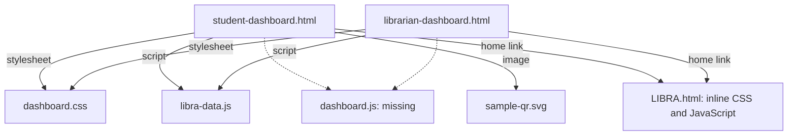

# LIBRA: Beginner's Code Explanation Guide

LIBRA stands for **Library Integrated Booking and Registration Assistant**. This project is a browser-based prototype for Cavite State University library visits. It contains a public landing page, student and librarian dashboard layouts, shared styling, and a small JavaScript module that manages sample accounts and attendance records.

This README explains all seven existing project files section by section. Read it beside the source files: the line ranges include blank lines and match the files at the time this guide was written. If the code changes, use the function names, element IDs, and CSS selectors to find the corresponding sections.

## Contents

- [Project overview](#project-overview)
- [Files and connections](#files-and-connections)
- [Viewing the project](#viewing-the-project)
- [Reading the code](#reading-the-code)
- [LIBRA.html](#libra-html)
- [student-dashboard.html](#student-html)
- [librarian-dashboard.html](#librarian-html)
- [dashboard.css](#dashboard-css)
- [libra-data.js](#libra-data-js)
- [JavaScript text copy](#javascript-text-copy)
- [sample-qr.svg](#sample-qr-svg)
- [Examples of how the pieces work together](#examples-of-how-the-pieces-work-together)

## Project overview

The student layout provides places for a QR preview, visit statistics, visit history, and a profile update. The librarian layout provides places for attendance statistics, hourly traffic, a student directory, and manual check-ins.

The folder is unfinished. Understanding the current implementation helps explain why some controls do not work yet:

| Part | Current behavior |
| --- | --- |
| Landing page | Its inline CSS and JavaScript provide navigation, animated scrolling, a mobile menu, and a login dialog. |
| Landing-page login | Submitting the form displays a demonstration notice. It does not call the shared sign-in function or open a dashboard. |
| Dashboard layouts | Both HTML files load the shared stylesheet and data module. They also request `dashboard.js`, which is absent from this folder. |
| Dashboard interactions | Data display, view switching, filters, pagination, chart rendering, form actions, and sign-out need the missing controller code. Most content therefore remains empty, hidden, or filled with placeholder text. |
| Shared data module | `libra-data.js` contains working browser-storage operations and demo business rules, but the supplied pages do not wire dashboard controls to those operations. |
| Student QR | `sample-qr.svg` is static artwork. It contains no student information and is not intended for scanning. |
| Server-side features | This folder contains no backend, database service, real account authentication, QR scanner, or QR generator. |

There are no project configuration files, automated tests, installed-library folders, or build outputs in the supplied folder. The HTML files themselves declare the local assets and external font resources they use.

## Files and connections

| File | Purpose |
| --- | --- |
| [LIBRA.html](LIBRA.html) | Public landing page, with its CSS and JavaScript written directly inside the HTML file. |
| [student-dashboard.html](student-dashboard.html) | Structure and controls for the student workspace. |
| [librarian-dashboard.html](librarian-dashboard.html) | Structure and controls for the librarian workspace. |
| [dashboard.css](dashboard.css) | Shared appearance and responsive layouts for both dashboards. |
| [libra-data.js](libra-data.js) | Sample data, browser storage, demo sessions, validation, profile updates, and manual attendance recording. |
| [LIBRA-DATA JS (CHANGE FILE TYPE TO JS).txt](<LIBRA-DATA JS (CHANGE FILE TYPE TO JS).txt>) | A text-file copy of the shared JavaScript code. The HTML pages load the `.js` file. |
| [sample-qr.svg](sample-qr.svg) | QR-style placeholder image displayed on the student overview. |
| [README.md](README.md) | This Markdown document. It explains the project and does not execute application code. |

The diagram shows file references in the supplied code. Dashed arrows mark the script that the dashboards request but cannot find.



`LIBRA.html` currently has no link or successful-login redirect to either dashboard, and it does not load `libra-data.js`. The text copy is also not referenced by any HTML page.

All three pages request the Manrope font from Google Fonts. The landing page additionally requests a library photograph from Unsplash for its hero background. Those external resources are not files stored in this project.

## Viewing the project

Open [LIBRA.html](LIBRA.html) in a browser to view the public page. You can open either dashboard HTML file directly to inspect its layout; the missing `dashboard.js` still prevents the dashboard interactions from being initialized.

For experimenting with browser storage, serve all the files from one local address. A browser **origin** is the combination of protocol, host, and port, such as `http://127.0.0.1:8000`. Pages on that origin can share the demo's `localStorage`. Storage behavior for directly opened `file:` URLs can vary between browsers.

If Python's Windows launcher is installed, open a terminal in this project folder and run:

```powershell
py -m http.server 8000 --bind 127.0.0.1
```

Then visit:

- `http://127.0.0.1:8000/LIBRA.html`
- `http://127.0.0.1:8000/student-dashboard.html`
- `http://127.0.0.1:8000/librarian-dashboard.html`

This command serves the existing files. It does not add backend features or supply the missing dashboard script.

The data module defines these example credentials:

| Role | Identifier | Password | Sample account |
| --- | --- | --- | --- |
| Student | `2026-0001` | `libra123` | Maria Santos |
| Librarian | `LIB-001` | `libra123` | Ana Reyes |

Student identifiers run from `2026-0001` through `2026-0012`. These credentials are accepted by `LibraDemo.signIn()`; the current landing-page form does not call that function.

## Reading the code

| Term | Meaning in this project |
| --- | --- |
| HTML | Describes page content: headings, links, forms, tables, and sections. |
| CSS | Controls appearance: colors, spacing, layout, and behavior at different screen widths. |
| JavaScript | Runs instructions, responds to events, and reads or changes data. |
| SVG | Describes an image using shapes and coordinates. The QR artwork and dashboard icons use SVG. |
| DOM | The browser's live representation of the HTML. JavaScript uses it to find and change page elements. |
| Function | A named group of instructions, such as `openLogin()`, that runs when called. |
| Object / array | An object holds named values, such as a student's name. An array holds a list, such as all students. |
| Selector | A way to identify elements. `.panel` selects a class; `#loginModal` selects an ID; `[hidden]` selects an attribute. |
| Event / listener | An event is something that happens, such as a click. A listener is code registered to respond to it. |
| JSON | A text format used to save JavaScript objects in browser storage. |
| Promise / `async` operation | Represents work that may finish later. Profile updates and manual entries return promises because they run through the locking helper. |
| API | A set of operations other code can call. Here, `window.LibraDemo` exposes the shared module's operations inside the browser. |

HTML attributes have different jobs. For example:

```html
<section class="view" id="history" data-panel="history" hidden>
```

`class="view"` connects the section to CSS. `id="history"` gives it a unique name and allows a link such as `#history` to target it. `data-panel="history"` gives JavaScript a custom label to read. `hidden` keeps the section out of view until code removes that attribute.

The dashboard `data-*` attributes and element IDs provide connection points for the missing controller. Attributes label elements; they do not implement filtering or navigation by themselves.

<a id="libra-html"></a>

## LIBRA.html

This is the public entry page. It combines three parts in one file: HTML content, a `<style>` block, and an inline `<script>` block.

### Document setup: lines 1-9

`<!DOCTYPE html>` tells the browser to use modern HTML rules. `lang="en"` identifies the page language. The character-set declaration supports UTF-8 text, while the viewport declaration lets the layout use the actual device width on phones.

The title appears in the browser tab. The two `preconnect` links prepare connections to Google's font services, and the stylesheet link requests several weights of Manrope. The CSS also supplies fallback fonts if Manrope cannot load.

### Embedded CSS: lines 10-170

CSS is inside this page because the landing page has its own layout. A rule contains a selector followed by properties, for example `.btn-primary { background: var(--green); color: white; }`.

| Source lines | Code section | What it does |
| --- | --- | --- |
| 11-23 | `:root` variables | Stores reusable theme values: green and gold colors, text colors, borders, surfaces, background, shadow, and header height. `var(--green)` reads one of these values. |
| 24-38 | Global rules and focus styles | Includes padding and borders in element sizes, removes default body spacing, sets fonts and line spacing, and styles links and buttons. Smooth scrolling and `scroll-margin-top` help section links. Keyboard focus gets a gold outline; programmatically focused sections suppress their own outline. |
| 39-77 | `.topbar`, `header`, branding, and navigation | Arranges the information strip and header with Flexbox. The sticky header remains at the top while scrolling. The seal is drawn with CSS, and navigation links change color on hover or when marked with `aria-current="location"`. |
| 78-85 | Buttons and mobile menu toggle | Defines shared button spacing, borders, and primary/outline colors. The primary button moves slightly on hover. The menu toggle starts hidden and becomes visible at the mobile breakpoint. |
| 86-97 | Hero and main container | Layers a green gradient over the external library photograph. Centers the introductory text and limits content width. `clamp()` lets the main heading grow with the viewport while keeping minimum and maximum font sizes. |
| 98-118 | Content panels, service cards, and announcements | Gives cards borders and rounded corners, lays services out in three columns, and creates a two-column About area. Styles headings, date labels, and announcement separators. |
| 119-126 | Steps and footer | Places the four explanation steps in a grid, draws numbered circles, and styles the dark green footer with wrapping content. |
| 127-145 | Login dialog and form | Makes the backdrop cover the screen. `.show` reveals the backdrop or notice. Styles the scrollable dialog, role tabs, selected-tab state, labels, inputs, focus effects, and action buttons. |
| 146-149 | Reduced-motion preference | Disables smooth CSS scrolling and selected transitions when the user asks their device to reduce motion. |
| 150-155 | Screens up to 960 pixels | Turns navigation into a dropdown opened by `nav.open`, shows the menu toggle, and reduces the steps grid to two columns. |
| 156-169 | Screens up to 600 pixels | Tightens spacing, simplifies branding, and stacks service cards, About panels, and steps in one column. |

Line 10 opens the style block, and line 170 closes it. Flexbox arranges elements along a row or column; Grid divides an area into rows and columns. These are the main layout tools used here.

### Visible page sections: lines 171-305

| Source lines | HTML section | What it does |
| --- | --- | --- |
| 171-176 | Body and information strip | Closes the head, opens the body, and displays the university/library service labels. |
| 177-200 | Header | Contains the LIBRA brand and `mainNav` links to `#about`, `#services`, `#announcements`, and `#how`. Access LIBRA (`loginButton`) and the menu button (`menuToggle`) use `onclick` to call `openLogin()` and `toggleMenu()`. |
| 201-209 | Main area and `#home` | Displays the introductory hero. `tabindex="-1"` allows JavaScript to focus the section after navigating to it. The inline style highlights the LIBRA name in gold. |
| 210-230 | `#about` | Explains the proposed system and its goal in two panels. Some inline styles customize only these paragraphs and panels. |
| 231-246 | `#services` | Displays static cards describing QR registration, attendance history, and library information. |
| 247-274 | `#announcements` | Displays three hard-coded reminders. They are page content rather than messages fetched from a server. |
| 275-292 | `#how` | Presents the proposed four-step workflow: login, get a QR, scan, and check in. The text describes the intended system; the supplied prototype does not implement the scanning workflow. Closes the main area. |
| 293-305 | Footer | Displays the project name, expanded abbreviation, prototype description, and a hard-coded 2026 copyright year. |

### Login-dialog HTML: lines 306-337

The `loginModal` backdrop contains the dialog. `role="dialog"`, `aria-modal="true"`, and `aria-labelledby="loginTitle"` describe it to assistive technology. Showing, closing, and keyboard interactions come from the script below.

The role tabs, `studentLoginTab` and `librarianLoginTab`, use `data-login-role` to distinguish student and librarian, `aria-selected` to describe the active tab, and `aria-controls` to identify the corresponding panel.

The `loginForm` contains a hidden `loginRole` input. `studentLoginPanel` supplies `studentNumber` and `password`; `librarianLoginPanel` supplies `librarianId` and `librarianPassword`. Password inputs mask characters on screen. Both panels declare required fields, but the librarian inputs initially have `disabled` so the browser does not require inactive credentials.

`loginNotice` is a hidden status message until its `show` class is applied. Cancel calls `closeLogin()`. Sign In submits the form, which the inline script intercepts.

### Inline JavaScript: lines 338-490

#### Element references and initial state: lines 338-349

The constants find the dialog, notice, form, role input, tab buttons, header, navigation, and menu button in the DOM. `Array.from()` converts the selected tab elements into an array for iteration.

`window.matchMedia()` reads the reduced-motion preference. `scrollFrame` remembers the scheduled animation frame so scrolling can be cancelled.

#### Menu state and header sizing: lines 350-363

`setMenuOpen(open)` adds or removes the navigation's `open` class. It also updates `aria-expanded` and the menu button label to reflect the visible state.

`updateHeaderHeight()` writes the measured header height into the `--header-height` CSS variable. It closes the mobile menu above 960 pixels. The function runs immediately, when a `ResizeObserver` detects a header-size change, and when the browser window resizes.

#### Scrolling helpers: lines 364-400

`stopScroll()` cancels the pending animation frame and clears its stored identifier.

`scrollToSection(target)` first stops any existing animation. It measures the current position and calculates a destination just below the sticky header, with 16 pixels of extra space. It limits the destination to the page's valid scrolling range.

If reduced motion is enabled or the distance is tiny, it moves immediately and focuses the destination section. Otherwise, its nested `animateScroll(timestamp)` function uses `requestAnimationFrame()` to move over 600 milliseconds. The easing calculation makes movement start and end gradually. At completion it focuses the section with `preventScroll: true`, preserving the calculated position.

#### Current link and section-link clicks: lines 401-424

`updateCurrentLink()` compares each navigation link's fragment, such as `#about`, to the URL fragment. Matching links receive `aria-current="location"`. The highlight follows the URL; this function does not detect which section is visible during ordinary scrolling.

The click listeners for `a[href^="#"]` handle ordinary clicks on links within this page. They find the target by ID, prevent the browser's default fragment jump, close the menu, update the URL with `history.pushState()`, update the highlight, and call `scrollToSection()`. Modified clicks are left to the browser.

The initial call sets the highlight on page load. A `hashchange` updates it later. Back/forward navigation, mouse-wheel movement, and touch gestures cancel an active animation.

#### General keyboard listener: lines 425-435

Arrow, Page Up/Down, Home, End, and Space keys stop animated scrolling. Escape closes the login dialog if open; otherwise it closes an open mobile menu and returns focus to the menu button.

#### Switching login roles: lines 436-450

`selectLoginRole(role)` updates the hidden role value and selects the matching tab. It changes tab accessibility attributes, shows the matching panel, and disables inputs in the other panel. This prevents hidden required fields from blocking form submission.

It also updates the dialog description in `loginDescription` and hides any previous notice.

#### Role-tab click and keyboard listeners: lines 451-465

Clicking a tab calls `selectLoginRole()`. Arrow Left/Right cycle between tabs; Home and End select the first or last tab. The modulo calculations wrap the index at either end of the array. Focus moves to the selected tab.

#### Opening and closing controls: lines 466-484

`openLogin()` stops scrolling, closes the menu, selects the student role, shows the dialog, and focuses the student-number field.

`closeLogin()` hides the dialog, resets the form, restores the student role, and returns focus to Access LIBRA. `toggleMenu()` reverses the menu's current state.

The backdrop's click listener closes the dialog only when the backdrop itself is clicked. Clicking inside the dialog does not satisfy that condition.

#### Login-form submission: lines 485-490

`event.preventDefault()` prevents the form from navigating or reloading the page. The listener writes a message for the selected role and reveals the notice.

This section does not verify credentials, call `LibraDemo.signIn()`, or redirect to a dashboard. Lines 491-492 close the body and HTML document.

<a id="student-html"></a>

## student-dashboard.html

This file defines the student's dashboard structure. It contains HTML and inline SVG icons, while appearance comes from `dashboard.css` and data operations come from `libra-data.js`. The requested `dashboard.js` controller is missing, so the explanations below identify the purpose of each section without assuming its dynamic behavior has been implemented.

### Document setup and scripts: lines 1-13

The doctype, language, UTF-8, viewport, title, and Google Fonts links have the same jobs as on the landing page.

The stylesheet link loads `dashboard.css`. The two script tags request `libra-data.js` followed by `dashboard.js`. Their `defer` attributes tell the browser to execute these ordinary external scripts after parsing the HTML, in their document order, so the elements are available to JavaScript.

The data module can load successfully even though the second file is absent. Loading it creates `window.LibraDemo`; populating this page still requires controller code.

### Role label and skip link: lines 14-15

`data-dashboard="student"` labels this body as a student workspace for JavaScript to read. It does not authenticate the visitor.

The Skip to content link targets `dashboardMain`, allowing keyboard users to bypass the sidebar.

### Sidebar branding and views: lines 16-36

The `aside` element contains the navigation area. Its brand link goes back to `LIBRA.html`, and the `seal` is a styled text badge.

| Navigation link | Connection points | Icon and purpose |
| --- | --- | --- |
| Overview | `href="#overview"`, `data-view="overview"` | Four SVG rectangles form a grid icon. This view contains the welcome message, visit statistics, QR preview, and recent visits. |
| Visit history | `href="#history"`, `data-view="history"` | SVG paths form a history/clock icon. This view contains visit filters and a history table. |
| Profile settings | `href="#profile"`, `data-view="profile"` | A circle and path form a person icon. This view contains account-editing controls and a profile summary. |

`aria-current="page"` initially marks Overview as active for assistive technology and CSS. The other links need code to change this attribute and reveal their corresponding hidden panels.

Each icon has `aria-hidden="true"` because the link text already explains its purpose. The sidebar note is static reminder text.

### Account area, sign-out, and backdrop: lines 37-48

`account-initials`, `account-name`, and `account-id` are reusable classes marking places where account information should appear. The initials `MS`, the word Student, and the dash are initial placeholders.

`signOutButton` is a button with a decorative SVG sign-out icon. It needs a listener to call the module's `signOut()` and handle navigation.

`sidebarBackdrop` is a hidden, screen-covering button intended to close the mobile sidebar. Its label describes that action, and `tabindex="-1"` keeps it out of ordinary Tab navigation. Showing it and responding to clicks require the controller.

### Main shell, top bar, and heading: lines 49-63

`main-shell` creates the area beside the desktop sidebar. The sticky top bar contains `sidebarToggle`, the university title, an empty `currentDate` time element, and the Demo workspace badge.

`sidebarToggle` identifies the sidebar with `aria-controls` and starts with `aria-expanded="false"`. These attributes describe state; they do not open the sidebar by themselves.

`dashboardMain` is the main content and skip-link target. `viewTitle` and `viewDescription` start with Overview text and provide places for a controller to update the heading. Their focus-related attributes support keyboard navigation.

`appError` is a hidden alert container for application-level errors.

### Overview welcome and statistics: lines 64-74

The `overview` section is visible initially. `data-panel="overview"` matches the sidebar's `data-view="overview"`. Its welcome banner contains `welcomeName`, initially Maria.

Three statistic cards provide these display targets:

| Element IDs | Intended display |
| --- | --- |
| `studentTotalVisits` | The signed-in student's total recorded entries. |
| `studentMonthVisits`, `studentMonthLabel` | Entries in the relevant month and the month label. |
| `studentLastVisit`, `studentLastTime` | The most recent entry's date and time. |

The cards initially show dashes and static helper text. Their book, calendar, and clock SVG icons are decorative. No calculation or DOM update is implemented in this HTML section.

### QR preview: lines 75-82

The QR panel loads `sample-qr.svg` through an `img` element. Its width and height describe the image dimensions, and its `alt` text explains that this is artwork without student information.

`account-id`, `account-name`, and `account-program` mark the student-details labels below the image. The horizontal rule visually separates those labels from the reminder.

The Sample QR badge and caption describe the image accurately: it is a preview, not a personalized code generated from the account.

### Recent visits and reminders: lines 83-95

`studentRecentVisits` is an empty table body intended for the student's three latest entries. The column headings are Date, Time, and Entry.

The table's caption uses `sr-only` to give screen-reader users a description without displaying additional text. Each `scope="col"` heading identifies a column.

The second panel contains a static ordered reminder list: prepare a QR, present it at the scanner, and ask for a manual entry if needed. The list's styled numbers are part of the layout. This block closes the overview section.

### Visit-history view: lines 96-109

This section starts with `hidden`. Its `data-panel="history"` matches the history navigation link.

| Element IDs | Purpose |
| --- | --- |
| `historyCount` | Displays the visit count. |
| `historyFrom`, `historyTo` | Date inputs for choosing a range. |
| `historyMethod` | Selects all entries, QR entries, or manual entries. Its option values match the module's `method` values. |
| `historyMessage` | A hidden status container for a history-related message, such as a filter problem. |
| `studentHistoryRows` | Empty table body for dates, times, entry methods, and status labels. |
| `historyPageInfo`, `historyPrev`, `historyNext` | Pagination information and previous/next controls. |

The HTML supplies the controls and column structure. It contains no filtering, ordering, page-size, or pagination algorithm; those would belong to the missing dashboard script.

### Profile form: lines 110-126

The hidden `profile` view contains the `profileForm`. Its `profileUpdateBadge` badge and `profileRule` notice explain the intended one-update rule.

| Form element | What the code specifies |
| --- | --- |
| `profileStudentNumber` | Read-only student number. It is displayed but cannot be edited through this input. |
| `profileName` | Required full name, with a minimum of 2 and maximum of 80 characters. |
| `profileProgram` | Required program dropdown. It initially has no options; code needs to populate it from `LibraDemo.PROGRAMS`. |
| `profileEmail` | Required email input, limited to 120 characters, with browser email-format checking. |
| `profileAgreement`, `profileAgreementLabel` | Required checkbox and its wrapping label, acknowledging the single permitted save. |
| `profileMessage` | Hidden status container for a save result or error. |
| `profileActions`, `profileSaveButton` | Container and submit button for saving. |

`name="name"`, `name="program"`, and `name="email"` identify the form values. `data-profile-field` marks the three editable profile fields so a controller can find them together. The browser provides basic field validation; the shared module separately validates values and enforces the one-update rule when `updateProfile()` is called.

The checkbox requirement belongs to this form. The data function itself receives name, program, and email, and does not check a checkbox.

### Profile summary: lines 127-136

The summary repeats account initials, name, program, student number, and email using the shared `account-*` classes. `profileStatus` starts with Available, while the text explains that saved details should appear in the librarian directory.

Using the same classes in several places allows controller code to update every label for a given account. This file contains the display targets rather than that update code.

### Footer, toast, and document ending: lines 137-142

The footer identifies the project and sample workspace. The year is initially 2026 inside a `current-year` span; there is no year-update logic in this file.

`toast` is a hidden status container for brief notifications. The remaining tags close the main area, shell, body, and document.

<a id="librarian-html"></a>

## librarian-dashboard.html

This file defines the librarian's dashboard structure. Like the student page, it loads the shared CSS and data module and requests the absent `dashboard.js`. The librarian-specific panels are display and input structures awaiting controller behavior.

### Document setup, role label, and skip link: lines 1-15

The head sets the page language, encoding, viewport, tab title, and font. It loads `dashboard.css`, then the two deferred script references.

`data-dashboard="librarian"` labels the workspace for a script. The skip link targets `dashboardMain`. The role label itself does not check a session or restrict access.

### Sidebar navigation: lines 16-26

The brand links to the landing page. Each sidebar link supplies a fragment and matching `data-view` value:

| View | Icon | Purpose |
| --- | --- | --- |
| `overview` | Four rectangles | Today's summary and latest check-ins. |
| `traffic` | Bar-chart paths | Hourly visitor counts and busiest hour. |
| `attendance` | Clipboard shapes | Searchable attendance records. |
| `directory` | People shapes | Registered students and profile-update status. |
| `manual` | Pencil paths | Student lookup and a manual-entry form. |

Overview initially has `aria-current="page"`. Icons are decorative and hidden from assistive technology; link text names each action. The note below the links is static guidance for scanner downtime.

### Account area and mobile backdrop: lines 27-32

The initials `AR`, Librarian label, and dash are placeholders marked with `account-initials`, `account-name`, and `account-id`.

`signOutButton` and `sidebarBackdrop` have the same intended jobs as their student-page equivalents. Both require event listeners, and the backdrop starts hidden.

### Top bar, main heading, and error container: lines 33-42

The top bar contains the mobile `sidebarToggle`, university title, empty `currentDate`, and demo badge. The main heading provides `viewTitle`, `viewDescription`, and a `viewDate` badge, initially Today.

`dashboardMain` is the main content and skip-link target. `appError` is a hidden alert container for errors.

### Overview welcome and statistics: lines 43-49

Overview starts visible. `welcomeName` initially contains Ana. The three statistic cards provide:

| Element IDs | Intended display |
| --- | --- |
| `todayEntries` | Today's total entries, counting QR and manual methods. |
| `registeredStudents` | Number of accounts in the student directory. |
| `peakHour`, `peakHourNote` | Today's busiest hour and supporting entry-count text. |

The values begin as placeholders. Decorative sign-in, people, and clock icons support the card labels.

### Latest entries, entry methods, and daily details: lines 50-58

`librarianRecentEntries` is an empty table body intended for today's six latest check-ins. Its columns are Student, Time, and Entry.

The method panel contains `qrEntryCount` and `manualEntryCount` labels. The associated `qrProgress` and `manualProgress` elements start with inline `width:0%`. A controller would calculate proportions and update those widths; CSS only draws the tracks and fills.

`uniqueVisitors` is a target for the number of distinct students visiting today. Library hours, 7 AM-7 PM, and Philippine time are static labels. The hours label does not impose an opening-hours rule on `recordManualEntry()`.

### Visitor-traffic view: lines 59-68

This hidden panel provides `trafficTotal`, `trafficUnique`, `trafficPeak`, and `trafficPeakCount` for today's traffic statistics.

`trafficDate` labels the chart date. `trafficChart` is an empty container intended for a chart covering all 24 hours. The green and gold legend marks entries and the peak hour. `trafficReadout` is a status area for information about a selected or pointed-to hour.

`hourlyBreakdown` is an empty grid intended for per-hour counts. The data module's `trafficForDay()` computes the numbers, and the stylesheet contains chart styles, but the supplied folder has no chart-rendering or chart-interaction code.

### Attendance-log view: lines 69-77

The attendance panel provides a count badge, filters, a table, and pagination controls:

| Element IDs | Purpose |
| --- | --- |
| `attendanceCount` | Entry-count badge. |
| `attendanceSearch` | Search input for name or student number, limited to 80 characters. |
| `attendanceDate` | Date filter; the label says clearing it should show all dates. |
| `attendanceProgram` | Program filter, initially containing only All programs. |
| `attendanceRows` | Empty table body for student name, number, program, date, time, and method. |
| `attendancePageInfo`, `attendancePrev`, `attendanceNext` | Pagination text and controls. |

Search, date filtering, program options, and page navigation require controller code. Table captions and scoped headings provide accessible table structure.

### Student-directory view: lines 78-86

`directoryCount` displays the account count. `directorySearch` accepts a name or student-number search, and `directoryProgram` starts with All programs.

`directoryRows` is an empty table body with columns for name, student number, program, email, and profile-update status. A controller would read `state.students` and use `profileUpdatedAt` to display that status.

`directoryPageInfo`, `directoryPrev`, and `directoryNext` provide pagination controls. This view defines no librarian editing form or student-registration operation.

### Manual-entry form and student preview: lines 87-99

The hidden manual panel contains `manualEntryForm`. Its required `manualStudentNumber` input is limited to 20 characters and gives `2026-0001` as an example.

`manualStudentPreview` starts hidden and provides `previewInitials`, `previewName`, `previewStudentNumber`, and `previewProgram` for a matching account. `manualLookupMessage` is a hidden lookup-status area.

The instructions ask the librarian to confirm the student before recording. `manualEntryMessage` provides a result-status area, and `manualSubmit` starts disabled.

A controller would perform the lookup, reveal the preview, enable submission, and call `LibraDemo.recordManualEntry()`. That data function validates the account and duplicate rule and timestamps the visit; the HTML does none of those operations by itself.

### Recent manual entries: lines 100-102

`manualRecentRows` is an empty table body intended for today's five latest manual entries. Its columns are Student and Time. This block closes the manual view.

### Footer, toast, and ending tags: lines 103-108

The footer labels the librarian sample workspace and includes the initial year in `current-year`. `toast` is a hidden status container for brief messages. The closing tags finish the main content, shell, body, and document.

<a id="dashboard-css"></a>

## dashboard.css

Both dashboards use this stylesheet. It defines their common visual language and adjusts the layouts for smaller screens. CSS draws the interface; it does not fetch records, handle form submissions, calculate statistics, or toggle a menu in response to a click.

### Theme variables: lines 1-14

`:root` stores values that other rules reuse with `var()`. These include the green/gold theme, soft backgrounds, text colors, borders, surfaces, page background, and panel shadow.

`--sidebar-width` starts at 248 pixels. Both the sidebar width and the main area's left margin use it, keeping the desktop layout aligned. A later media query reduces it to 226 pixels.

### Global defaults, hidden elements, and keyboard focus: lines 15-24

`box-sizing: border-box` includes padding and borders in declared dimensions. The body rule sets the overall font, colors, background, and line spacing. Links inherit their text color, and form controls inherit the font.

`[hidden] { display: none !important; }` ensures elements carrying the HTML `hidden` attribute stay hidden even if another rule gives them a display layout such as Grid.

Disabled buttons use a faded appearance and a not-allowed cursor. Focusable links, buttons, inputs, and selects get a gold keyboard-focus outline. A focused main heading suppresses its outline, and common headings and paragraphs lose their default top margin.

### Icons and skip link: lines 25-27

`.icon` gives inline SVG icons a consistent size and outlined appearance. `currentColor` makes their stroke match the surrounding text color.

`.skip-link` normally sits above the visible screen. When it receives keyboard focus, `.skip-link:focus` brings it into view so the reader can jump to the main content.

### Sidebar, brand, navigation, and note: lines 28-40

`.sidebar` fixes the navigation to the left edge, fills the screen height, allows vertical scrolling, and uses a column layout. Its `z-index` places it above the mobile backdrop.

`.sidebar-brand`, `.seal`, and `.workspace-label` style the logo area and section label. `.sidebar-nav` spaces links in a grid.

`.sidebar-link` defines link spacing and hover colors. The `[aria-current="page"]` rule highlights the active link. Its `::before` pseudo-element draws the small green indicator beside that link; a pseudo-element is a decorative part created by CSS.

`.sidebar-note` gives the reminder a soft gold background and distinct heading.

### Sidebar account and sign-out: lines 41-48

`.sidebar-account` uses `margin-top: auto` to sit toward the bottom of the sidebar's column layout. `.account-row` places initials and account details side by side.

`.avatar` draws the circular initials badge. `.account-details` and its text rules allow long account names to wrap. `.sign-out` styles the full-width outlined button and its hover state.

### Main shell, top bar, badges, mobile controls, and workspace: lines 49-65

`.main-shell` leaves space for the desktop sidebar. `.dashboard-topbar` stays at the top while the main page scrolls. `.topbar-title` and `.topbar-meta` style the title, date, and status area.

`.badge` creates a rounded label. `.badge-green`, `.badge-gold`, and `.badge-neutral` choose the green, gold, and neutral color variants.

`.menu-button` starts hidden on desktop. `.sidebar-backdrop` defines the fixed dimmed layer for mobile navigation. Its visibility is separately controlled by the HTML `hidden` attribute.

`.workspace` limits and pads the content. `.page-heading`, `.eyebrow`, and the heading/paragraph rules style the title area. `.view` spaces panels with Grid, but does not select which view is active.

### Welcome banner: lines 66-72

`.welcome-banner` draws the green gradient panel with rounded corners. Its `::before` and `::after` pseudo-elements draw large decorative circles. `pointer-events: none` prevents those decorations from intercepting pointer interaction.

The nested eyebrow, heading, highlighted name, and paragraph rules set colors, sizes, and spacing.

### Statistic cards: lines 73-80

`.stats-grid` makes three equal columns. `minmax(0, 1fr)` allows each column to shrink within the available width.

`.stat-card`, `.stat-label`, `.stat-value`, and `.stat-note` style each statistic and its explanation. `.stat-value.compact` uses smaller type for a date or hour label. `.stat-icon` draws the icon tile, and its `.gold` variant changes the colors.

### Panels and overview layouts: lines 81-87

`.panel` is the reusable white content card. `.panel-heading` and its heading/paragraph rules arrange each panel's title and secondary text.

`.overview-grid` arranges the student's QR and adjacent content. `.librarian-overview-grid` arranges the librarian's latest entries and summary stack. `.stack` spaces vertically stacked cards.

### QR panel: lines 88-95

`.qr-panel` centers the preview while keeping its heading left-aligned. `.qr-frame` draws a padded border around the image and limits its width.

The image rule preserves its proportions and uses `image-rendering: pixelated` to keep square edges distinct when supported by the browser. `.qr-number`, `.qr-name`, and `.qr-caption` style the details and reminder. `.qr-divider` draws the dashed separator.

These rules affect the appearance of the existing image; they do not encode QR data.

### Detail rows, soft panels, and reminders: lines 96-105

`.detail-row` places a label and value on opposite sides. The adjacent-sibling selector `.detail-row + .detail-row` adds a separator only when one row follows another.

`.soft-panel` makes reminder panels pale green and removes their shadow. Its heading and paragraph rules adjust text.

`.reminder-list` replaces ordinary list-marker styling with a spaced layout, and `.reminder-number` draws the explicit numbered circles used in the student page.

### Tables and row helpers: lines 106-116

`.table-wrap` permits horizontal scrolling when a table is wider than its container. The table, `th`, and `td` rules set full width, collapsed borders, text sizes, spacing, separators, and header colors.

The final row loses its bottom border, and hovering over a row lightly changes its background. `.student-cell` styles a main name and secondary detail; `.nowrap` prevents wrapping; `.program-cell` sets space for program names; `.empty-state` styles a no-results message.

Some of these helper classes would be attached to rows created by the missing controller. Their CSS definitions do not create rows.

### Filters and input fields: lines 117-126

`.filters` arranges controls along a wrapping row. `.field` stacks each label and control, while the input/select rules set size, border, color, and focus styling.

Disabled or read-only fields use a muted background. `.field small` styles helper text. `.search-field`, `.filter-field`, and `.filter-program` give different controls preferred widths while allowing them to fit available space.

### Pagination and buttons: lines 127-135

`.pagination` separates page information from the previous/next controls. `.pagination-buttons` spaces the buttons.

`.btn` defines the common button layout. `.btn-primary`, `.btn-outline`, their hover rules, and `.btn-small` provide the visual variants. The buttons' actual actions depend on JavaScript listeners.

### Profile layout: lines 136-139

`.profile-grid` creates the form and summary columns. `.profile-form` spaces form sections; `.profile-fields` provides a two-column field layout.

`.full-width` spans a field across all grid columns. The supplied profile fields use this class, so those fields each occupy a full row even at larger sizes.

### Notices, agreement, and form actions: lines 140-146

`.notice` draws a gold information box. `.notice.success` uses green, and `.notice.error` uses red. A controller would select the appropriate classes and remove `hidden` when displaying a message.

`.agreement` places checkbox and acknowledgement text together. Its input rule sizes the checkbox and gives it a green accent. `.form-actions` aligns action buttons to the right.

### Profile summary: lines 147-152

`.profile-summary` centers the account card. `.large-avatar` enlarges the initials badge. Nested heading, paragraph, and detail-row rules handle text sizes, alignment, and long values such as an email address.

### Entry-method bars: lines 153-159

`.method-row` and `.method-label` space the method names and counts. `.progress-track` draws the empty background track, and `.progress-fill` draws its green fill. `.progress-fill.gold` is used for manual entries.

The fill width must come from HTML or JavaScript. These rules do not calculate the percentage.

### Traffic-chart styling: lines 160-173

`.chart-scroll` allows a wide chart to scroll horizontally, and `.traffic-chart` defines the intended SVG chart dimensions.

`.chart-grid` styles guide lines; `.chart-label` styles chart text; `.chart-bar` styles bars. The `.peak` variant is gold and `.zero` is pale. Hover/focus rules distinguish a pointed-to or focused bar.

`.chart-footer`, `.chart-legend`, and `.legend-dot` arrange the legend and readout area, including the gold peak indicator.

No chart SVG is present inside the HTML's empty `trafficChart` container. These rules are ready for chart elements that a controller would generate.

### Hourly count cards: lines 174-178

`.hourly-grid` starts with six columns. `.hour-card` styles each hour and count, and `.hour-card.peak` highlights the busiest hour. The data and card elements still need to be supplied by JavaScript.

### Manual-entry layout and preview: lines 179-186

`.manual-grid` places the entry form and recent-entries panel side by side. `.manual-form` spaces its fields.

`.student-preview` styles the matched account's initials, name, and secondary details. `.manual-instructions` styles the confirmation guidance. These styles do not perform student lookup.

### Footer, toast, errors, and screen-reader text: lines 187-190

`.workspace-footer` spaces the footer labels and lets them wrap. `.toast` positions a floating notification near the bottom-right corner above the other interface layers. `.app-error` adds spacing below an application error.

`.sr-only` visually clips descriptive text while keeping it available to screen readers. It is used for table captions.

### Responsive layouts and reduced motion: lines 191-244

A media query applies extra CSS when its condition matches. Screen-width breakpoints adapt the same HTML to different devices.

| Source lines | Condition | Changes |
| --- | --- | --- |
| 191-198 | Up to 1180 pixels | Narrows the desktop sidebar, reduces padding and card spacing, stacks the librarian overview, and adjusts profile-column proportions. |
| 199-207 | Up to 960 pixels | Moves the sidebar offscreen with `translateX(-100%)`. `.sidebar.open` brings it back. Removes the main left margin, shows the menu button, and adjusts top-bar height and profile columns. |
| 208-232 | Up to 700 pixels | Reduces spacing, hides the top-bar date and heading badge, stacks overview/profile/manual columns, simplifies statistic cards, uses four hourly columns, allows filters to wrap, and makes profile fields one column. |
| 233-241 | Up to 400 pixels | Further shrinks top-bar text, stacks statistic cards, restores their icons, uses three hourly columns, and stacks pagination information and controls. |
| 242-244 | Reduced motion requested | Disables transitions and smooth CSS scrolling, including transitions on pseudo-elements. |

The sidebar's CSS can animate between hidden and open positions, but a click handler is still needed to add or remove its `open` class and update the backdrop.

<a id="libra-data-js"></a>

## libra-data.js

This file manages the demo's data and rules. The dashboards load it as an ordinary browser script. It exposes an object named `window.LibraDemo` containing functions the rest of the application can call.

It uses browser storage instead of a backend. Loading the file creates the API object; sample records are created when `getState()` first runs and finds no saved data.

### Wrapper and browser initialization: lines 1-24

The outer function runs immediately. This pattern is called an **immediately invoked function expression**, or IIFE. It keeps helper variables inside the module instead of adding each one to the global browser scope.

`factory()` constructs the module's API. If a CommonJS environment supplies `module.exports`, the wrapper exports that API so it can also be loaded with `require()`. In a browser, the presence of `root.document` leads it to create `root.LibraDemo`.

`globalThis` refers to the environment's global object; the wrapper falls back to `this` if it is unavailable. The two `'use strict'` statements enable stricter JavaScript behavior in their respective function scopes.

The browser passes four services to `createStore()`:

| Service | Code behavior |
| --- | --- |
| `storage` | Wraps `localStorage.getItem()` and `localStorage.setItem()` for saved students, visits, and librarian accounts. |
| `sessionStorage` | Wraps reading, writing, and removing the current demo-session entry. |
| `notify` | Dispatches a `libra:datachange` custom event on the current window after a successful data save. |
| `lock` | Uses `navigator.locks.request('libra-demo-data', action)` when Web Locks are available. Otherwise it schedules the action through a promise. |

A lock lets cooperating pages take turns changing the shared data, reducing the chance that one save overwrites another. The promise fallback schedules the action but does not provide a shared lock between tabs.

The custom event provides a signal a page could listen for to refresh its content. It does not update the HTML by itself, and this module contains no cross-tab refresh listener.

### Constants and date formatter: lines 25-37

| Constant | Meaning |
| --- | --- |
| `DATA_KEY` | `libra.demo.data.v1`: the browser-storage name for the complete saved data object. |
| `SESSION_KEY` | `libra.demo.session.v1`: the name for the current tab's demo session. |
| `TIME_ZONE` | `Asia/Manila`: the default timezone used by date and traffic helpers. |
| `DEMO_PASSWORD` | `libra123`: the shared password checked for every sample account. |
| `PROGRAMS` | The eight accepted programs: Computer Science, Information Technology, Business Management, Secondary Education, Psychology, Nursing, Hospitality Management, and Criminology, using the full labels in the array. |

`dayFormatter` is an `Intl.DateTimeFormat` instance that extracts year, month, and day in Philippine time. Creating it once lets `dateKey()` reuse it.

### Date and time helpers: lines 38-67

| Function | What it does |
| --- | --- |
| `dateKey(value = new Date())` | Converts a date or timestamp into a Philippine-calendar key such as `2026-11-23`. It gets the formatted date parts, removes separators, converts the parts to named values with `Object.fromEntries()`, and joins year, month, and day. |
| `formatDate(value, options = {})` | Creates a readable date using Philippine locale and timezone defaults. A date-only value is interpreted as noon at UTC+8 to preserve its intended calendar date. The caller's optional formatting settings override defaults through `...options`. |
| `formatTime(value)` | Displays a timestamp as a 12-hour Philippine time with hours and minutes, such as `9:30 AM`. |
| `hourLabel(hour)` | Turns a 24-hour number into an hour label: 0 becomes 12 AM, 12 becomes 12 PM, and 13 becomes 1 PM. |
| `visitHour(visit)` | Reads `checkedInAt` and returns its Philippine hour as a number from 0 to 23. This is a private helper used by traffic calculations. |

The saved timestamp and the display timezone serve different purposes. `checkedInAt` is stored as an ISO timestamp, usually ending in `Z` for UTC, while these helpers interpret it for Philippine dates and times.

### Daily traffic calculation: lines 68-82

`trafficForDay(visits, day)` filters the visits to the requested date and creates an array of 24 counters, one per hour. Each matching visit increases the counter returned by `visitHour()`.

It returns:

| Result field | Meaning |
| --- | --- |
| `hours` | The 24 hourly entry counts. |
| `entries` | Total records for that day, including repeat visits by a student. |
| `uniqueStudents` | Number of distinct student numbers, counted using a `Set`. |
| `peakHour` | The hour with the largest count, or `null` when no entries exist. If hours tie, the first matching hour is returned. |
| `peakCount` | The largest hourly count, or zero for an empty day. |
| `qr` | Number of records whose method is exactly `QR`. |
| `manual` | Number of records whose method is exactly `Manual`. |

This function calculates data without drawing a chart or changing a page.

### Creating sample records: lines 83-123

`seedData(now)` creates a complete starting data object for the supplied date and time.

The `people` list contains twelve names and program indexes. `.map()` turns each pair into a student object. Student numbers are generated with zero-padding, such as `2026-0001`. Emails are formed from lowercased names with spaces replaced by dots, followed by `@example.com`. Every student starts with `profileUpdatedAt: null`.

The nested loops then generate visits:

1. Check today and the previous 20 days.
2. Skip Sundays.
3. Use hours 7 through 18, representing 7 AM through 6 PM.
4. Create six candidate entries at 9 AM, five at 10 AM, four at 8 AM, and three at other included hours.
5. Derive minutes and select students from the arrays.
6. Skip candidate timestamps later than `now`.
7. Mark some entries Manual using the remainder calculation; the others are QR.

The generated pattern creates useful sample traffic, particularly around 9 AM, while avoiding future entries. Results vary with the supplied date and time.

The returned state has this structure:

| State field | Contents |
| --- | --- |
| `version` | The format version, currently 1. |
| `createdAt` | When the sample state was created, as an ISO timestamp. |
| `students` | The twelve student objects. |
| `visits` | The generated attendance records. |
| `librarians` | One sample account: `LIB-001`, Ana Reyes. |

Each student has `studentNumber`, `name`, `program`, `email`, and `profileUpdatedAt`. Each visit has `id`, `studentNumber`, `name`, `program`, `day`, `checkedInAt`, and `method`. The visit's name and program are copies of the student's details at recording time.

### Constructing the store: lines 124-129

`createStore(options)` groups the storage operations and account rules into one object. It receives the storage services, then uses supplied or default functions for the current time, notification, and locking.

The defaults use `new Date()`, an empty notification callback, and promise scheduling. Allowing services and the clock to be passed in makes the data code reusable without tying every operation directly to a browser global.

The functions nested inside `createStore()` keep access to these services through their surrounding scope, called a **closure**. Creating the store does not immediately call `getState()`.

### Saving state: lines 130-135

`save(state)` uses `JSON.stringify()` to convert the state object to text and writes it under `DATA_KEY`.

If saving fails, the `catch` block throws an error explaining that the browser could not save the demo. If saving succeeds, it calls `notify()`. This helper is private to the store.

### Loading or initializing state: lines 136-153

`getState()` reads the saved text from storage. If storage cannot be read, it throws a readable storage error.

If no entry exists, it calls `seedData(now())`, saves the result, and returns it. Otherwise, it uses `JSON.parse()` to convert saved text back into a JavaScript object.

It then checks that the format version is 1 and that `students`, `visits`, and `librarians` are arrays. Malformed JSON or an unsupported structure causes an error rather than silently replacing the saved state. These checks validate the top-level structure, not every field in every record.

`getState()` is available without signing in. Account restrictions are checked by the relevant operations, rather than by this general data-reading function.

### Reading the demo session: lines 154-161

`getSession()` parses the entry under `SESSION_KEY`. It accepts a session only if its role is student or librarian and its ID is a string. Missing, unreadable, or invalid session data returns `null`.

This session uses `sessionStorage`, which is scoped to the browser tab's page session. Saved project data uses `localStorage`, which normally survives page reloads and browser restarts and is shared by pages on the same origin.

### Demo sign-in: lines 162-175

`signIn(role, identifier, password)` loads the state, trims the identifier, and changes it to uppercase. It looks for either a matching student number or a matching librarian ID, according to the role.

It rejects a missing account or any password different from `libra123`. On success it stores `role`, `id`, and `signedInAt` in the session, then returns the matched account.

If session storage cannot be written, it throws a session-start error. The timestamp records sign-in time; the code does not implement session expiry.

These are client-side demo checks with a shared password. They do not contact a server or implement production account authentication.

### Account lookup and role requirement: lines 176-190

`currentAccount(role)` reads the current session. If no session exists or the role differs, it returns `null`. Otherwise it loads the state and finds the corresponding account, returning `null` if the account is absent.

`requireRole(role)` calls that lookup and throws an error when it cannot find an account for the required role. It returns the account when the check succeeds.

`currentAccount()` is public. `requireRole()` is a private helper used to require a student for a profile update and a librarian for manual attendance.

### Profile validation: lines 191-202

`validateProfile(values)` builds a cleaned profile:

- `name`: trims the ends and reduces repeated whitespace to a single space.
- `program`: trims the value.
- `email`: trims it and converts it to lowercase.

It requires a name between 2 and 80 characters, a program exactly matching an entry in `PROGRAMS`, and an email no longer than 120 characters matching the simple email pattern.

The regular expressions identify whitespace and check an email's basic `name@domain.suffix` structure. They do not verify that the email account exists. The function returns the cleaned profile without saving it.

### One-time profile update: lines 203-218

`updateProfile(values)` returns the result of a locked operation, so callers should await its promise or handle it with `.then()` and `.catch()`.

Inside the operation it:

1. Requires a signed-in student.
2. Reads the current state and finds that student's record.
3. Rejects a record that already has `profileUpdatedAt`.
4. Validates and cleans the submitted values.
5. Rejects a submission where all three cleaned values are unchanged, leaving the update available.
6. Copies the changed profile onto the record with `Object.assign()` and records the update timestamp.
7. Saves the complete state and returns the updated student.

The timestamp is the marker that prevents a second update. The student number stays the same because it is not one of the fields copied from the submitted profile.

This function updates `state.students`; it does not rewrite older visits. Their stored names and programs remain the snapshots recorded when those entries were created.

### Recording manual attendance: lines 219-241

`recordManualEntry(studentNumber)` also returns a promise from a locked operation. It requires a signed-in librarian, cleans the student number, and looks for a registered student.

An unknown number causes an error. For a known number, it checks existing visits for that student. A record from the preceding 60,000 milliseconds, including the current instant, blocks another entry. This check includes both QR and manual records and ignores timestamps later than the current time.

The rule prevents another check-in within one minute. It does not limit the student to one visit per day or restrict entries to the static library-hours label.

When accepted, the function creates a visit with:

| Field | Value |
| --- | --- |
| `id` | A `manual-` prefix, current timestamp, and a short random suffix. |
| `studentNumber`, `name`, `program` | The matched student's identifier and current details. |
| `day` | Today's Philippine date from `dateKey(timestamp)`. |
| `checkedInAt` | The current time as an ISO timestamp. |
| `method` | `Manual`. |

It appends the record to `state.visits`, saves the full state, and returns the new visit. There is no equivalent live QR-recording function in this module; its QR entries come from sample generation.

### Sign-out: lines 242-243

`signOut()` removes only the entry under `SESSION_KEY`. Student records, visits, and profile-update timestamps remain saved under `DATA_KEY`, so signing out does not restore the one-time profile update.

The function itself does not redirect the browser or clear page labels. A controller would handle those interface changes.

### Public store API and module exports: lines 244-253

The object returned by `createStore()` exposes these groups:

| Group | Public names |
| --- | --- |
| Settings | `DATA_KEY`, `SESSION_KEY`, `TIME_ZONE`, `DEMO_PASSWORD`, `PROGRAMS` |
| State and sessions | `getState`, `getSession`, `signIn`, `signOut`, `currentAccount` |
| Profile and attendance | `updateProfile`, `validateProfile`, `recordManualEntry` |
| Date and reporting helpers | `dateKey`, `formatDate`, `formatTime`, `hourLabel`, `trafficForDay` |

This returned store is what the browser wrapper assigns to `window.LibraDemo`. Internal helpers such as `save()`, `requireRole()`, and `visitHour()` are not exposed on that store.

The final factory return provides `createStore`, `seedData`, the date/reporting helpers, `PROGRAMS`, `DATA_KEY`, and `SESSION_KEY` for module consumers. That export allows other code to create its own store with supplied services. The final closing line ends the wrapper.

<a id="javascript-text-copy"></a>

## LIBRA-DATA JS (CHANGE FILE TYPE TO JS).txt

This file contains the same JavaScript code as `libra-data.js`. Comparing their contents while ignoring carriage-return characters shows that their code is identical. The `.txt` copy uses Windows CRLF line endings, while the `.js` file uses LF line endings.

The filename describes a text copy intended to become a JavaScript file. The JavaScript version already exists as `libra-data.js`, and both dashboard pages explicitly load that version. Editing the text copy alone therefore does not change the code those pages execute.

The detailed [libra-data.js explanation](#libra-data-js) applies to this file as well. This section map covers all its code without repeating the same explanations:

| Source lines | Section and purpose |
| --- | --- |
| 1-24 | IIFE wrapper, strict mode, CommonJS export support, and browser storage/event/lock services. |
| 25-37 | Storage keys, Philippine timezone, shared demo password, accepted programs, and reusable date formatter. |
| 38-67 | `dateKey()`, `formatDate()`, `formatTime()`, `hourLabel()`, and private `visitHour()`. |
| 68-82 | `trafficForDay()`: daily totals, hourly counts, unique students, peak hour, and method totals. |
| 83-123 | `seedData()`: student accounts, generated visit history, and the sample librarian account. |
| 124-129 | `createStore()`: supplied services, default callbacks, and clock setup. |
| 130-153 | Private `save()` and public `getState()`: JSON saving, loading, first-use seeding, and format checks. |
| 154-161 | `getSession()`: reading and validating the saved session. |
| 162-175 | `signIn()`: account lookup, shared-password check, and session creation. |
| 176-190 | `currentAccount()` and private `requireRole()`: account retrieval and role checks. |
| 191-202 | `validateProfile()`: cleaning and checking name, program, and email. |
| 203-218 | `updateProfile()`: the locked, single permitted profile update. |
| 219-241 | `recordManualEntry()`: librarian-only recording and the one-minute duplicate check. |
| 242-243 | `signOut()`: removing the session entry. |
| 244-253 | Public store API, factory exports, and wrapper closing code. |

<a id="sample-qr-svg"></a>

## sample-qr.svg

This is a vector image used by the student QR-preview panel. Every square is already described in the file. Nothing in this SVG reads an account, encodes a student number, or generates a QR code.

### SVG setup: line 1

`xmlns="http://www.w3.org/2000/svg"` identifies the SVG format. `viewBox="0 0 33 33"` gives the image a 33-by-33 coordinate area that the browser scales to its displayed size.

`shape-rendering="crispEdges"` requests sharp shape edges. `role="img"` describes the SVG as an image, and `aria-labelledby="title desc"` connects it to the following text descriptions.

### Accessible description and source comment: lines 2-4

`title` names it LIBRA sample QR artwork. `desc` states that it is a static placeholder containing no student data and not intended for scanning.

The HTML comment repeats that it is a sample and identifies a real QR generator's output as the eventual replacement. Comments explain source code and are not visible artwork.

### Background: line 5

The white rectangle covers the entire 33-by-33 drawing area. It supplies a clean background behind the green shapes.

### Green pattern: lines 6-9

The `g` element groups shapes and applies dark green to them. The first path draws three large corner squares. The long second path draws fixed smaller blocks across the image.

A path's `d` attribute is a sequence of drawing commands. In this file, `M` moves to an absolute coordinate, `h` and `v` draw relative horizontal and vertical segments, `H` draws to an absolute horizontal coordinate, and `z` closes a shape.

For example, `M4 4h7v7H4z` starts at coordinate (4, 4), moves right 7 units, moves down 7 units, returns horizontally to x=4, and closes the square.

### Corner-square centers: lines 10-11

The white group on line 10 draws smaller white squares inside the three large green corner squares. The green group on line 11 places still smaller green squares inside those white areas.

Together they create the familiar nested-square appearance of QR corner markers. Here they are fixed decorative shapes.

### Closing tag: line 12

`</svg>` ends the vector image. The student's `img` element references this file, and the dashboard stylesheet controls the preview frame around it.

## Examples of how the pieces work together

These data flows are available to a JavaScript caller. Connecting them to page controls requires the missing dashboard controller and a connection from the landing-page login to the data module.

| Action | Data behavior | Related display targets |
| --- | --- | --- |
| Sign in as `2026-0001` | `signIn('student', '2026-0001', 'libra123')` loads or seeds state, finds Maria's account, and saves a student session. `currentAccount('student')` can then retrieve it. | Student `account-name`, `account-id`, `account-program`, and `welcomeName`. |
| Save a changed student profile | `updateProfile(values)` checks the student session, validates the values, saves the details, and sets `profileUpdatedAt`. A second save is rejected. | Profile labels, `profileStatus`, and the librarian's `directoryRows` when refreshed from the saved students. |
| Record a manual entry as a librarian | `recordManualEntry('2026-0001')` verifies the librarian session, finds Maria, checks the last-minute rule, and saves a Manual visit. | Librarian attendance/recent-entry tables, the student's history, and summary counts when refreshed. |
| Calculate today's traffic | `trafficForDay(state.visits, dateKey())` groups today's records into 24 hours and computes totals and the peak hour. | `todayEntries`, `uniqueVisitors`, `trafficChart`, and `hourlyBreakdown`, after a controller renders them. |

For example, three recorded visits by the same student on one day count as **three entries** but **one unique student**. That distinction explains why the total-entry and unique-visitor cards can show different numbers.

Saving data dispatches the `libra:datachange` event in the current window. A future listener can use that event to re-read state and refresh the relevant interface. The existing HTML and CSS provide the places to show the results.
